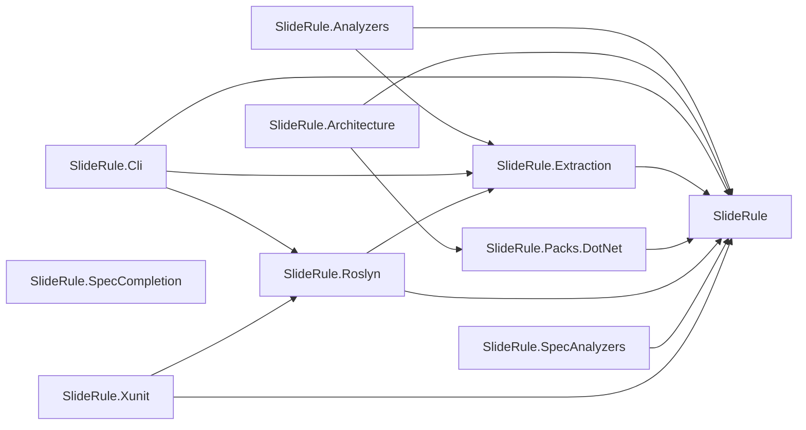
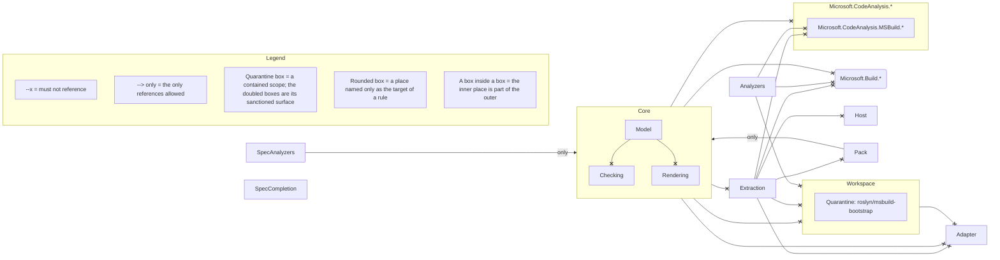

# Architecture

This page draws SlideRule's own architecture twice. `sliderule render` wrote both drawings from this repository.

The first is the codebase survey of the projects that make up SlideRule and the references between
them. A solid arrow is a reference some type makes, and a dotted arrow is a project reference that is
declared and never used. The survey is drawn from what the code does.

The second is the architecture law, drawn from the spec. It shows the places the spec names (its
layers, the namespaces inside them and the external namespaces its rules forbid), the references it
forbids and the scope it quarantines. A `Migrate` rule would add its baselined debt as a dotted arrow,
and this spec has none left. The legend is generated with the drawing, one row for each kind of mark it
uses. [SlideRule on itself](https://github.com/andypgray/sliderule/blob/main/SELF-CHECK.md#the-graph)
walks through both drawings.

<!-- sliderule:begin -->
*Generated by `sliderule render` from `SlideRule.slnx` — do not edit between the markers; re-render to update.*



*Generated by `sliderule render` from `SlideRule.Architecture`. Do not edit between the markers; edit the spec and re-render.*



Not drawn in full: `layering/no-circular-references`, `layering/leaves-independent`, `layering/spec-completion-stands-alone`, `api/core-front-door`, `api/extraction-front-door`, `api/workspace-front-door`, `api/host-front-door`, `model/constraint-nodes`, `model/reified-nodes-immutable`, `packaging/core-netstandard-only`, `packaging/core-carries-nothing`, `packaging/shipping-locks-restore`, `packaging/only-the-named-ship`, `di/no-captive-dependencies`, `di/no-service-locator`, `di/no-buildserviceprovider`, `cli/no-stdout`, `mcp/tools-accept-cancellation`, `mcp/tool-types-attributed`, `mcp/tool-types-in-cli`, `mcp/no-blocking-waits`, `mcp/no-path-assembly-loads`, `mcp/warm-state-constructed-once`, `mcp/env-through-seam`, `roslyn/no-msbuildlocator-query`, `xunit/throws-setup-errors-only`, `analyzer/no-ambient-types`, `analyzer/no-ambient-members`, `exceptions/no-swallowed-broad-catches`, `exceptions/no-bare-bcl-throws`, `state/no-static-mutable`, `naming/async-suffix`, `naming/interfaces`, `roslyn/msbuild-bootstrap/containment` (Quarantine), `roslyn/msbuild-bootstrap/tripwire` (Quarantine), `model/prose-fragments/tripwire` (Caution). Expand any of them with `sliderule explain <rule-id>`.
<!-- sliderule:end -->

The test
[`SelfSpecTests.ArchitectureMd_IsCurrent`](https://github.com/andypgray/sliderule/blob/main/tests/SlideRule.Tests/Dogfood/SelfSpecTests.cs)
composes the block in process and fails unless the committed block already equals it. A drawing that
drifts from the code or the spec therefore fails the suite.

The two drawings are scoped differently, and the `sliderule.json` at the repository root records how.
The survey draws only declared projects, so it leaves out the MyApp fixture projects, which the spec
fixtures bring into the build through project references. The file's `render.diagram.only` list narrows that
further, because all 24 declared projects would crowd the drawing. It keeps the four packages that ship,
the four assemblies that ship inside them, the rule pack and the spec project. The law is never scoped,
because what the spec forbids does not depend on which projects someone chose to draw. It can therefore
name a place the survey leaves out, and the two drawings still agree.

The line under the law fence lists, by ID, every rule the drawing cannot place in full. Most are rules
about names, shapes, attributes and members, which have no arrow to draw. The others include rules with
no single direction, such as the ban on circular references, and the tripwires of the two scopes. The
quarantine is drawn as a box, but its containment rule is listed too, because its sanctioned surface is
chosen by name. The Caution scope over Model appears only on that line.

To redraw both from the root of a checkout, where `sliderule.json` names the solution, the spec and
this file as the drawing's target:

```bash
dotnet build SlideRule.slnx
sliderule render
```
