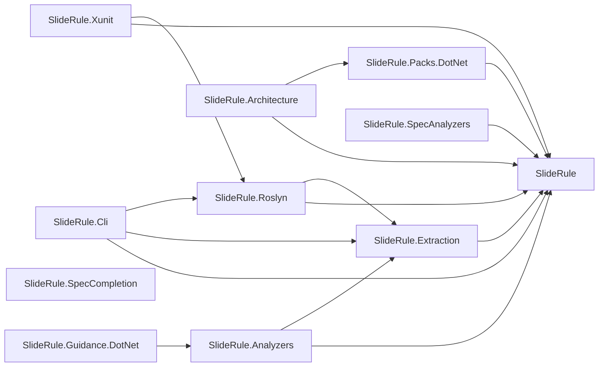
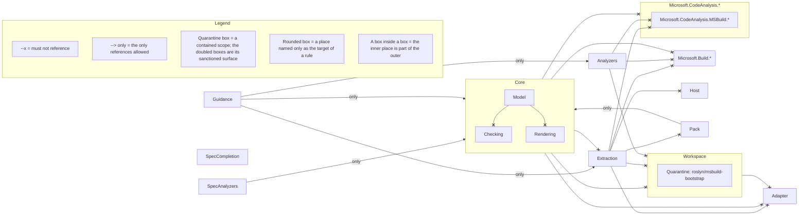

# Architecture

`sliderule render` generated both drawings below from this repository's solution and spec. The root `sliderule.json` names `ARCHITECTURE.md` as their target. [SlideRule on itself](https://github.com/andypgray/sliderule/blob/main/SELF-CHECK.md#the-graph) walks through both under "The graph".

The first drawing, accessibly titled `Codebase survey: SlideRule.slnx`, shows projects and references extracted from code, without a spec. A solid `-->` marks a cross-project reference the code makes; a dotted `-.->` marks a declared project reference it never uses. Labels omit type and reference counts, so the survey changes only when the project graph changes.

The second, `Architecture law: SlideRule.Architecture`, uses the spec alone, without extracting code, running checks or reading baselines. It nests Model, Checking and Rendering inside Core and includes forbidden outside namespaces `Microsoft.CodeAnalysis.*` and `Microsoft.Build.*`. Rounded boxes mark places named only as rule targets. A `--x` forbids a reference; arrows labelled `only` indicate allow-lists; `Quarantine: roslyn/msbuild-bootstrap` marks the quarantined scope. A `Migrate` rule would draw the same relation as `Enforce`, with a dotted arrow labelled as grandfathered debt. This spec has no `Migrate` rules. The generated legend has one row per kind of mark used, omitting unused marks.

<!-- sliderule:begin -->
*Generated by `sliderule render` from `SlideRule.slnx` — do not edit between the markers; re-render to update.*



*Generated by `sliderule render` from `SlideRule.Architecture`. Do not edit between the markers; edit the spec and re-render.*



Not drawn in full: `layering/no-circular-references`, `layering/leaves-independent`, `layering/spec-completion-stands-alone`, `api/core-front-door`, `api/extraction-front-door`, `api/workspace-front-door`, `api/host-front-door`, `model/constraint-nodes`, `model/reified-nodes-immutable`, `packaging/core-netstandard-only`, `packaging/core-carries-nothing`, `packaging/compiler-hosted-netstandard`, `packaging/compiler-hosted-take-only-the-compiler`, `packaging/mcp-sdk-in-cli-only`, `packaging/xunit-in-adapter-only`, `packaging/shipping-locks-restore`, `packaging/shipping-carries-docs`, `packaging/strong-named`, `packaging/only-the-named-ship`, `di/no-captive-dependencies`, `di/seams-constructed-at-root`, `di/no-service-locator`, `di/no-buildserviceprovider`, `cli/no-stdout`, `mcp/tools-accept-cancellation`, `mcp/tool-types-attributed`, `mcp/tool-types-in-cli`, `mcp/no-blocking-waits`, `mcp/no-path-assembly-loads`, `mcp/warm-state-constructed-once`, `mcp/env-through-seam`, `roslyn/no-msbuildlocator-query`, `xunit/throws-setup-errors-only`, `xunit/hooks-overridable`, `xunit/hooks-protected`, `analyzer/no-ambient-types`, `analyzer/no-ambient-members`, `exceptions/no-swallowed-broad-catches`, `exceptions/no-bare-bcl-throws`, `state/no-static-mutable`, `naming/async-suffix`, `naming/interfaces`, `roslyn/msbuild-bootstrap/containment` (Quarantine), `roslyn/msbuild-bootstrap/tripwire` (Quarantine), `model/prose-fragments/tripwire` (Caution). Expand any of them with `sliderule explain <rule-id>`.
<!-- sliderule:end -->

[`SelfSpecTests.ArchitectureMd_IsCurrent`](https://github.com/andypgray/sliderule/blob/main/tests/SlideRule.Tests/Dogfood/SelfSpecTests.cs) recomposes the whole managed block in process through the same composer as `render`. It requires an exact match with the committed block, so drift from the code or spec fails the suite.

The survey starts with the solution's 25 declared projects. It excludes `MyApp.Domain`, `MyApp.Legacy.Billing` and `MyApp.Web`, which fixture specs bring into the build through project references. The root `sliderule.json` sets `render.diagram.path` to `ARCHITECTURE.md` and narrows the survey through `render.diagram.only`. Its 11 entries cover every project outside tests and fixtures. They include five shipping packages (`SlideRule`, `SlideRule.Analyzers`, `SlideRule.Cli`, `SlideRule.Guidance.DotNet`, `SlideRule.Xunit`) and four bundled assemblies (`SlideRule.Extraction`, `SlideRule.Roslyn`, `SlideRule.SpecAnalyzers`, `SlideRule.SpecCompletion`). The rule pack `SlideRule.Packs.DotNet` and spec project `SlideRule.Architecture` complete the list. This scope affects only the survey; the law draws from the whole spec, so it can name places the survey leaves out, such as outside namespaces.

The line under the law lists rules it cannot draw in full, by ID and in authoring order; it disappears when all are drawn. Rules are listed for verbs without a single direction, subjects outside code regions, unplaceable operands or scope tripwires. For example, `layering/no-circular-references` has no single arrow direction. Tripwires draw no mark. Most entries concern names, shapes, attributes, packaging or members, including `api/*`, `naming/*` and `packaging/*`. For the quarantine boxed inside Workspace, the line includes both `roslyn/msbuild-bootstrap/containment` and `roslyn/msbuild-bootstrap/tripwire`. The containment rule is listed because its sanctioned surface, types named `MsBuildBootstrap`, cannot be drawn as a box. The Caution scope over Model has no box and appears only as `model/prose-fragments/tripwire`. Expand any entry with `sliderule explain <rule-id>`.

With no arguments, `sliderule render` reads the root `sliderule.json` for the solution, spec and diagram target. Build first so `render` can load the spec's compiled assembly. To redraw both drawings from the root of a checkout:

```bash
dotnet build SlideRule.slnx
sliderule render
```
