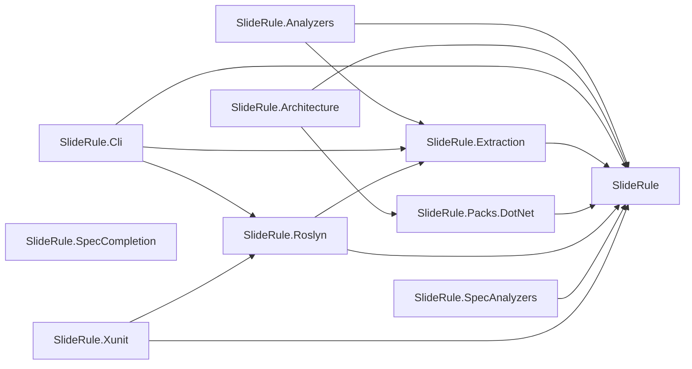
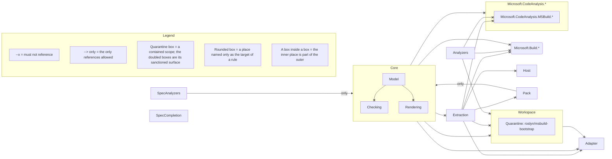

# Architecture

Two drawings of the same system, both written by `sliderule render` rather than by hand.

The first is the codebase survey of the projects that make up SlideRule and the references between
them. A solid arrow is a reference some type actually makes, and a dotted arrow is a project
reference that is declared and never exercised. The survey is drawn from what the code does.

The second is the architecture law, drawn from the spec instead. It shows the places the spec names,
the references it forbids, the debt it grandfathers and the scope it contains. Its legend is
generated with it, one row for each construct that particular drawing uses.

<!-- sliderule:begin -->
*Generated by `sliderule render` from `SlideRule.slnx` — do not edit between the markers; re-render to update.*



*Generated by `sliderule render` from `SlideRule.Architecture`. Do not edit between the markers; edit the spec and re-render.*



Not drawn in full: `layering/no-circular-references`, `layering/leaves-independent`, `layering/spec-completion-stands-alone`, `api/core-front-door`, `api/extraction-front-door`, `api/workspace-front-door`, `api/host-front-door`, `model/constraint-nodes`, `model/reified-nodes-immutable`, `packaging/core-netstandard-only`, `packaging/core-carries-nothing`, `packaging/shipping-locks-restore`, `packaging/only-the-named-ship`, `di/no-captive-dependencies`, `di/no-service-locator`, `di/no-buildserviceprovider`, `cli/no-stdout`, `mcp/tools-accept-cancellation`, `mcp/tool-types-attributed`, `mcp/tool-types-in-cli`, `mcp/no-blocking-waits`, `mcp/no-path-assembly-loads`, `mcp/warm-state-constructed-once`, `mcp/env-through-seam`, `roslyn/no-msbuildlocator-query`, `xunit/throws-setup-errors-only`, `analyzer/no-ambient-types`, `analyzer/no-ambient-members`, `exceptions/no-swallowed-broad-catches`, `exceptions/no-bare-bcl-throws`, `state/no-static-mutable`, `naming/async-suffix`, `naming/interfaces`, `roslyn/msbuild-bootstrap/containment` (Quarantine), `roslyn/msbuild-bootstrap/tripwire` (Quarantine), `model/prose-fragments/tripwire` (Caution). Expand any of them with `sliderule explain <rule-id>`.
<!-- sliderule:end -->

Nobody drew either of those, and nobody can let them go stale. The test
[`SelfSpecTests.ArchitectureMd_IsCurrent`](https://github.com/andypgray/sliderule/blob/main/tests/SlideRule.Tests/Dogfood/SelfSpecTests.cs)
composes the block in process and asserts the committed file already equals it.

The two fences are scoped differently, and `sliderule.json` at the repository root records how. The
survey fence draws the projects this solution file declares. That is why the MyApp fixture solutions the tests check
against are absent from it. A spec fixture's project reference drags them into the build, and the
solution never claims them. The file's `render.diagram.only` list narrows within that set and
nothing else. The narrowing is for legibility alone. Drawing all twenty-four declared projects
would crowd the picture past what a reader can take in. The list therefore keeps it to the four
shipping packages and the two assemblies they carry. The rule pack, the spec analyzer, the completion
provider and the spec join them.
The law fence is never scoped, because what the spec forbids is not a property of the projects
someone chose to draw. So the law can name a place the survey dropped, and neither drawing
contradicts the other when it does.

The line under the law fence lists the rules no diagram can place. A rule about a name, a shape, an
attribute or a member has no arrow to draw. Such a rule is named there by ID and expanded with
`sliderule explain`. Nothing is silently left out.

To redraw both from the root of a checkout, where `sliderule.json` names the solution, the spec and
this file as the drawing's target:

```bash
dotnet build SlideRule.slnx
sliderule render
```
