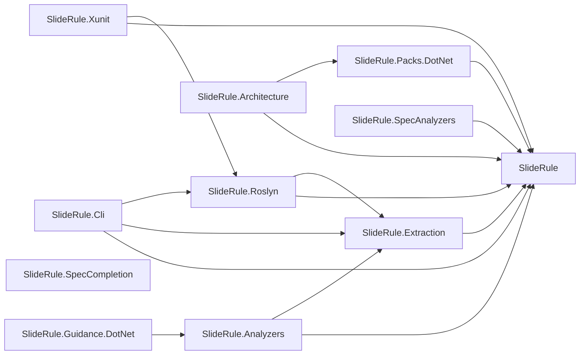
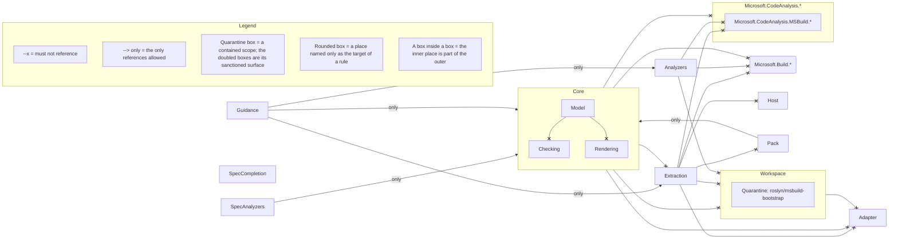

# SlideRule on itself

SlideRule is a .NET architecture checker that checks its own code against one C# spec. The `SlideRuleArchitectureSpec` class in [`SlideRuleArchitectureSpec.cs`](https://github.com/andypgray/sliderule/blob/main/arch/SlideRule.Architecture/SlideRuleArchitectureSpec.cs) defines 51 rules over this repository's real code, across 13 declared layers. The layers are Core, Model, Checking, Rendering, Extraction, Analyzers, SpecAnalyzers, SpecCompletion, Workspace, Host, Adapter, Pack and Guidance. Model, Checking and Rendering are namespaces within Core. The root rule list counts 50 rules and one [quarantined scope](https://github.com/andypgray/sliderule/blob/main/WRITING-SPECS.md#scopes), `roslyn/msbuild-bootstrap`, over `SlideRule.Roslyn.MsBuild.*` in Workspace. It excludes the Caution scope `model/prose-fragments` (over Model), which only warns. A check counts more rules, because it expands the quarantine into `<id>/containment` and `<id>/tripwire`, and Caution into a tripwire alone. Tripwires warn once per changed file declaring a scoped type; without a `--diff-base` diff they skip. The self-spec has no `Migrate` rule, so the [As SARIF](#as-sarif) examples use Meridian. The quarantine's containment baseline still grandfathers references from this repository's tests. The other fences show this spec or solution; [Why these excerpts can be trusted](#why-these-excerpts-can-be-trusted) describes their checks.

## This repo's own spec

The `cli/no-stdout` rule prevents direct console output from the CLI project. Its `host` layer is `arch.Layer("Host", arch.Project("SlideRule.Cli"))`, which selects every type that project declares:

```csharp
        arch.Rule("cli/no-stdout")
            .Enforce(host
                .MustNotUse(
                    arch.Member(() => Console.Out),
                    arch.Member(typeof(Console), nameof(Console.Write)),
                    arch.Member(() => Console.WriteLine())))
            .Because("Stdout is a protocol channel here — the MCP server speaks JSON-RPC over it and CLI " +
                     "output flows through System.CommandLine's console — so a direct Console write corrupts " +
                     "the wire and is invisible to the in-process tests.")
            .Citation("https://modelcontextprotocol.io/specification/2025-06-18/basic/transports#stdio")
            .Fix("Write CLI output through the command's InvocationConfiguration console; route server " +
                 "diagnostics to the logger or Console.Error.");
```

Each `arch.Member` identifies a member by its declaring type and name, covering every overload. The `Console.WriteLine()` expression therefore also bans `Console.WriteLine("x")`. Parameterless lambdas must read or invoke one static member, so a method call must compile. The type-and-name form names `Console.Write` without calling it; `Write` has no parameterless overload.

`sliderule mcp` runs the MCP server over stdio. A direct write to its stdout corrupts the JSON-RPC traffic, and bypasses the console the in-process CLI tests observe. Because this is an `Enforce` rule, any banned use anywhere in Host fails `check`.

## The prose it generates

`sliderule render` updates a managed block in the root [`AGENTS.md`](https://github.com/andypgray/sliderule/blob/main/AGENTS.md), which [coding agents read](https://github.com/andypgray/sliderule/blob/main/CODING-AGENTS.md#the-context-files), between `<!-- sliderule:begin -->` and `<!-- sliderule:end -->`. Each rule bullet contains its ID, a sentence derived from the constraint and any citation. The root omits `Because`. A layer gets a directory card when an `Enforce` or `Migrate` rule has that layer as its subject. Union subjects remain in the root; scope rules get scope cards. Workspace has no layer card. Cards include the `Because` verbatim, as on the Host card, [`src/SlideRule.Cli/AGENTS.md`](https://github.com/andypgray/sliderule/blob/main/src/SlideRule.Cli/AGENTS.md):

```markdown
- `cli/no-stdout` — The Host layer must not use `Console.Out`, `Console.Write()` or `Console.WriteLine()`. Stdout is a protocol channel here — the MCP server speaks JSON-RPC over it and CLI output flows through System.CommandLine's console — so a direct Console write corrupts the wire and is invisible to the in-process tests. See <https://modelcontextprotocol.io/specification/2025-06-18/basic/transports#stdio>.
```

[`SelfSpecTests.AgentsMd_IsCurrent`](https://github.com/andypgray/sliderule/blob/main/tests/SlideRule.Tests/Dogfood/SelfSpecTests.cs) composes the root block in process and compares it with the committed text. `ScopedCards_AreCurrent` checks every card a render would produce and rejects committed cards with no current placement. MCP tools read the same model and return the CLI's `--json` documents byte for byte.

The fixed markers record no version. The CLI binds a compiled spec to its own contract, regardless of the spec's reference version. A mismatch fails only when the spec needs unavailable API, so an older CLI can re-render older content without warning. Keep the CLI and spec package versions aligned, as [Operating SlideRule](https://github.com/andypgray/sliderule/blob/main/OPERATING.md#upgrading) explains. `render --check` writes nothing and exits 1 if any rendered file would change. [CI](https://github.com/andypgray/sliderule/blob/main/OPERATING.md#ci) runs it in `self-check` through the action's `render-check` input, enabled by default, and for all four [examples](https://github.com/andypgray/sliderule/blob/main/README.md#examples).

## When an agent breaks it

Suppose an agent adds a progress printer with two `Console.WriteLine` calls to make a slow solution load visible. The configuration in [`hooks/`](https://github.com/andypgray/sliderule/tree/main/hooks) registers `sliderule hook` for `Stop` and `SubagentStop`, each with a 600-second timeout, and for `UserPromptSubmit`. At a turn-end event, the hook checks the working tree. A red rule makes it exit 2, Claude Code's blocking code, which prevents the stop and returns the report to the agent. The hook writes the report to stderr:

```text
FAIL cli/no-stdout — The Host layer must not use `Console.Out`, `Console.Write()` or `Console.WriteLine()`.
  because: Stdout is a protocol channel here — the MCP server speaks JSON-RPC over it and CLI output flows through System.CommandLine's console — so a direct Console write corrupts the wire and is invisible to the in-process tests.
  citation: https://modelcontextprotocol.io/specification/2025-06-18/basic/transports#stdio
  fix: Write CLI output through the command's InvocationConfiguration console; route server diagnostics to the logger or Console.Error.
  subject: 270 types, 2 generated
  src/SlideRule.Cli/Rendering/ProgressPrinter.cs:10 — SlideRule.Cli.Rendering.ProgressPrinter uses System.Console.WriteLine()
  src/SlideRule.Cli/Rendering/ProgressPrinter.cs:15 — SlideRule.Cli.Rendering.ProgressPrinter uses System.Console.WriteLine()
```

This is one stanza from the full report, which includes passing rules in spec order and ends with a summary. Failed stanzas give the ID and sentence, `because`, optional `citation`, `fix` and `exemplar`, then each offending `file:line`. The `subject:` count appears on passing or failing rules only when their subjects include generated types. Blocking is capped per prompt: after N consecutive red rounds, the hook exits 1 under `sliderule: still red after N rounds; not blocking again.` SlideRule's own failures also exit 1, never 2. The fix directs CLI output through the command's `InvocationConfiguration` console and server diagnostics to the logger or `Console.Error`. The agent moves the two writes to the command's console, and the next stop passes.

## When a rule reaches a type you did not expect

`explain --type` shows why a type is covered or exempt. It starts with the full name, kind, declaring projects and files. Groups then trace its `layers`, `rules`, `scopes`, `operand of`, `excepted by` and `not evaluated` claims; operand claims include their roles. Empty groups disappear, and an unclaimed type gets a one-line explanation. `explain --path` answers for every type under a file or directory. This excerpt for `CommandEntryPoint`, the CLI's command shell, keeps the header, Host membership and exception trace. Its intervening `rules` and `operand of` groups are omitted:

```text
SlideRule.Cli.CommandEntryPoint (class)
  project: SlideRule.Cli
  file: src/SlideRule.Cli/CommandEntryPoint.cs
  layers:
    Host
      declared by project `SlideRule.Cli`
  excepted by:
    rule exceptions/no-swallowed-broad-catches: Types in the Core, Extraction, Analyzers, SpecAnalyzers, SpecCompletion, Workspace, Host, Adapter, Pack or Guidance layers, except types named `ArchChecker`, `ArchRuleTests`, `BuildTierEngine`, `CommandEntryPoint`, `IdleTimeoutWatchdog`, `ParentProcessWatcher`, `ServerShutdown`, `SpecLiteralAnalyzer` or `VsWhereLocator`
      in the Host layer
        declared by project `SlideRule.Cli`
      removed by the except: types named `ArchChecker`, `ArchRuleTests`, `BuildTierEngine`, `CommandEntryPoint`, `IdleTimeoutWatchdog`, `ParentProcessWatcher`, `ServerShutdown`, `SpecLiteralAnalyzer` or `VsWhereLocator`
        it is named `CommandEntryPoint`
```

`exceptions/no-swallowed-broad-catches` bans swallowing `Exception` across the shipping layers, with the named exceptions shown above. `CommandEntryPoint` catches failures, reports them through `CliErrorMapper` and exits 2. Operator cancellation prints `Cancelled.` and also exits 2. The exemption uses `arch.Types.Named`, which matches simple names across namespaces and projects. A second `CommandEntryPoint` in those layers would qualify too. Over MCP, pass a full or simple name to `arch_explain`'s `type` parameter.

## In xUnit

The [xUnit adapter](https://github.com/andypgray/sliderule/blob/main/src/SlideRule.Xunit/README.md) runs the same spec through `ArchRuleTests<TSpec>`. Its `Rule_Holds` theory has one row per rule, with the rule ID as the display name. This repository uses [one class declaration](https://github.com/andypgray/sliderule/blob/main/tests/SlideRule.Tests/Dogfood/AdapterSelfSpecTests.cs):

```csharp
public sealed class AdapterSelfSpecTests : ArchRuleTests<SlideRuleArchitectureSpec>
{
    protected override string SolutionPath => FindSolutionUp("SlideRule.slnx");
}
```

A failed verdict fails its row with the stanza `check` prints. Baselined violations pass, so a `Migrate` row stays green while its baseline covers every violation and site count. [CI](https://github.com/andypgray/sliderule/blob/main/.github/workflows/ci.yml) runs this class with detailed output in "Self-spec as named xUnit tests (one test per rule)", producing a line per ID. The adapter targets `net10.0`; test projects need `net10.0` or later. Its [requirements](https://github.com/andypgray/sliderule/blob/main/src/SlideRule.Xunit/README.md#requirements) include xunit.v3 4.0.1 or later, Microsoft.Testing.Platform and a .NET SDK on the test host.

## In the build

The [build analyzer](https://github.com/andypgray/sliderule/blob/main/src/SlideRule.Analyzers/README.md) reports violations as compiler warnings at the offending code. By default it reads the nearest `sliderule.model.json` at or above the project directory, written by `render --model`. All six IDs default to Warning: `SR2001`, `SR2002`, `SR2090`, `SR2091`, `SR2092` and `SR2093`. Meridian, Meridian.Quoting, Meridian.Operations and Meridian.Interchange attach the analyzer by project path. The [`examples` CI job](https://github.com/andypgray/sliderule/blob/main/.github/workflows/ci.yml) promotes all six IDs to errors for each build. This repository's own src projects use the last published analyzer, pinned by `SlideRuleAnalyzersVersion` to 0.3.0. Seven use a private `PackageReference`; Core, Extraction and the analyzer project download the package to avoid dependency cycles. This exercises the previous release's model reader. The [`self-check` CI job](https://github.com/andypgray/sliderule/blob/main/.github/workflows/ci.yml) builds `SlideRule.slnx` with the same IDs as errors. The analyzer checks only the rules one compilation can decide. Project-file packaging rules, `MustBelongTo` front doors, circular-reference rules and scope tripwires require `check` over the solution. The tripwires are `roslyn/msbuild-bootstrap/tripwire` and `model/prose-fragments/tripwire`.

## As SARIF

`check --sarif <path>` writes a SARIF 2.1.0 report alongside the usual output. The self-spec has no `Migrate` rule. `mcp/env-through-seam` is an `Enforce` rule without a baseline. It bans `Environment.GetEnvironmentVariable`, `GetEnvironmentVariables`, `ExpandEnvironmentVariables` and `SetEnvironmentVariable` outside `SystemEnvironment` in Host. To show a migration baseline, these fences use the [Meridian example](https://github.com/andypgray/sliderule/tree/main/examples/Meridian):

```csharp
        arch.Rule("data-access/no-inline-sql")
            .Migrate(
                from: "Controllers open SqlConnection and run inline SQL directly.",
                to: arch.Namespace("Meridian.Web.Controllers.*")
                    .MustNotReference(typeof(SqlConnection), typeof(SqlCommand)))
            .Because("Data access behind a repository can be tested and swapped; SQL in the request path cannot.")
            .Fix("Move the SQL into a repository.")
            .Exemplar(arch.Types.Named("BookingRepository"));
```

Its 12 baselined violations keep the rule green. Each entry records a controller's reference to one SQL type and its site count. SARIF emits one result per site. Baselined sites have level `note`, state `unchanged` and an `external` suppression. Its justification also appears in the message, because code-scanning alerts display the level and message and ignore the suppression. The attribution is `grandfathered: <reason>` when an entry has a reason, or `grandfathered in <baseline file>` otherwise. One result object from a fresh run:

```json
{
  "ruleId": "data-access/no-inline-sql",
  "level": "note",
  "message": {
    "text": "Meridian.Web.Controllers.CustomsController references Microsoft.Data.SqlClient.SqlCommand (grandfathered in arch/baselines/data-access/no-inline-sql.json)"
  },
  "locations": [
    {
      "physicalLocation": {
        "artifactLocation": {
          "uri": "examples/Meridian/src/Meridian.Web/Controllers/CustomsController.cs",
          "uriBaseId": "SRCROOT"
        },
        "region": {
          "startLine": 27
        }
      }
    }
  ],
  "partialFingerprints": {
    "slideRuleViolationIdentity/v1": "v1|T:Meridian.Web.Controllers.CustomsController|T:Microsoft.Data.SqlClient.SqlCommand||src/Meridian.Web/Controllers/CustomsController.cs|0"
  },
  "baselineState": "unchanged",
  "suppressions": [
    {
      "kind": "external",
      "justification": "grandfathered in arch/baselines/data-access/no-inline-sql.json"
    }
  ]
}
```

A red violation has level `error`, state `new` and no `suppressions`; a baselined pair exceeding its recorded count uses `updated`. The artifact `uri`, under `SRCROOT`, is relative to the repository root, where code scanning resolves it. The `slideRuleViolationIdentity/v1` fingerprint is `v1|<source>|<target>|<subject>|<path>|<ordinal>`, with a solution-relative path. Reproduce the file from a checkout:

```bash
dotnet build examples/Meridian/Meridian.slnx
sliderule check examples/Meridian/Meridian.slnx --sarif sliderule.sarif
```

The [`self-check` CI job](https://github.com/andypgray/sliderule/blob/main/.github/workflows/ci.yml) uses this repository's action to check its spec and upload SARIF on every pull request and push to `main` or `master`. Uploads skip pull requests from forks and runs Dependabot starts outside a pull request, whose tokens cannot write alerts. A Dependabot pull request from the same repository can upload. The default `upload-sarif: auto` also skips private repositories.

`check --json` emits one entry per rule with its identity, posture, verdict, prose, exemplar, baseline counts, violations and warnings. MCP's `arch_check` returns that document byte for byte. Here is the same rule:

```json
{
  "id": "data-access/no-inline-sql",
  "posture": "migrate",
  "status": "passed",
  "sentence": "Types in `Meridian.Web.Controllers.*` must not reference `SqlConnection` or `SqlCommand`.",
  "because": "Data access behind a repository can be tested and swapped; SQL in the request path cannot.",
  "fix": "Move the SQL into a repository.",
  "exemplar": [
    {
      "type": "Meridian.Web.Data.BookingRepository",
      "sites": [
        {
          "file": "src/Meridian.Web/Data/BookingRepository.cs",
          "line": 6
        }
      ]
    }
  ],
  "baseline": {
    "path": "arch/baselines/data-access/no-inline-sql.json",
    "grandfathered": 12,
    "stale": 0
  },
  "violationCount": 0,
  "violations": [],
  "warnings": []
}
```

`grandfathered` counts violations still covered by the baseline, once per controller/type pair regardless of site count. `stale` counts entries with no current match. `sliderule baseline accept-reductions` removes those entries and lowers recorded site counts; it never adds. With a captured baseline, a `Migrate` rule is promotable when measured as written with no grandfathered violations, failures or stale entries. `status` then prints `0 remaining; promotable to Enforce (baseline is empty)`.

## The graph

`sliderule graph` surveys projects, declared and observed references, namespace type counts and external references grouped by namespace root. It needs no spec and has no `--spec` option. It prints 28 project lines for this solution, one for every project the workspace load reaches. Fixture spec projects are included. Their project references also bring in `MyApp.Domain`, `MyApp.Legacy.Billing` and `MyApp.Web`, each marked `(not a solution member)`. The excerpt shows its 11 projects outside the tests, under `src/` and `arch/`:

```text
  SlideRule — 403 types; targets netstandard2.0; references: (none); packages: (none); locks restore
  SlideRule.Analyzers — 15 types; targets netstandard2.0; references: SlideRule, SlideRule.Extraction; packages: Microsoft.CodeAnalysis.Analyzers (private); locks restore
  SlideRule.Architecture — 1 type; targets net10.0; references: SlideRule, SlideRule.Packs.DotNet; packages: Microsoft.Build.Locator; does not pack
  SlideRule.Cli — 269 types (2 generated); targets net10.0; references: SlideRule, SlideRule.Extraction, SlideRule.Roslyn; packages: Microsoft.Extensions.Hosting, ModelContextProtocol, Serilog.Extensions.Hosting, Serilog.Sinks.File, SlideRule.Analyzers (private), System.CommandLine; locks restore
  SlideRule.Extraction — 66 types; targets netstandard2.0; references: SlideRule; packages: Microsoft.CodeAnalysis.CSharp; does not pack; locks restore
  SlideRule.Guidance.DotNet — 2 types; targets netstandard2.0; references: (none); undeclared references: SlideRule.Analyzers; packages: Microsoft.CodeAnalysis.Analyzers (private), Microsoft.CodeAnalysis.CSharp (private), SlideRule.Analyzers (private); locks restore
  SlideRule.Packs.DotNet — 2 types; targets net10.0; references: SlideRule; packages: Microsoft.Extensions.DependencyInjection, Microsoft.Extensions.DependencyInjection.Abstractions, SlideRule.Analyzers (private); does not pack; locks restore
  SlideRule.Roslyn — 136 types (14 generated); targets net10.0; references: SlideRule, SlideRule.Extraction; packages: Basic.CompilerLog.Util, MSBuild.StructuredLogger, Microsoft.Build (private), Microsoft.Build.Framework (private), Microsoft.Build.Locator, Microsoft.Build.Tasks.Core (private), Microsoft.Build.Utilities.Core (private), Microsoft.CodeAnalysis, Microsoft.CodeAnalysis.CSharp.Workspaces, Microsoft.CodeAnalysis.Workspaces.MSBuild, Microsoft.NET.StringTools (private), SlideRule.Analyzers (private), System.Security.Cryptography.Xml (private); does not pack; locks restore
  SlideRule.SpecAnalyzers — 5 types; targets netstandard2.0; references: SlideRule; packages: Microsoft.CodeAnalysis.Analyzers (private), Microsoft.CodeAnalysis.CSharp (private), SlideRule.Analyzers (private); does not pack; locks restore
  SlideRule.SpecCompletion — 13 types; targets netstandard2.0; references: (none); packages: Microsoft.CodeAnalysis.Analyzers (private), Microsoft.CodeAnalysis.CSharp (private), Microsoft.CodeAnalysis.Features (private), SlideRule.Analyzers (private); does not pack; locks restore
  SlideRule.Xunit — 3 types; targets net10.0; references: SlideRule, SlideRule.Roslyn; packages: Basic.CompilerLog.Util, MSBuild.StructuredLogger, Microsoft.Build.Framework (private), Microsoft.Build.Locator, Microsoft.Build.Utilities.Core (private), Microsoft.CodeAnalysis, Microsoft.CodeAnalysis.CSharp.Workspaces, Microsoft.CodeAnalysis.Workspaces.MSBuild, Microsoft.NET.StringTools (private), SlideRule.Analyzers (private), xunit.v3.assert, xunit.v3.extensibility.core; locks restore
```

Each project line gives type and generated-type counts, target frameworks, declared project references and packages, with private packages marked `(private)`. Generated counts appear only when nonzero. `undeclared references` lists compilation references unexplained by the declared references, directly or transitively. `does not pack` and `locks restore` appear only when those facts apply. The full survey starts with `Codebase survey: SlideRule.slnx` and `Projects (28):`. It then lists uncovered projects, observed project references as distinct type pairs, multiply declared types and names also supplied by referenced assemblies. Namespace inventories and external references follow.

Core, project `SlideRule`, contains the fluent API, compiled spec model and readers that need no compiler. Its line shows no project or package references. `layering/core-no-roslyn` forbids references to Extraction, Workspace, `Microsoft.CodeAnalysis.*` and `Microsoft.Build.*`. Type selections made with `arch.Project` include generated types: Roslyn's come from the regular-expression and JSON source generators, and the CLI's from the JSON one. Project-fact rules use `arch.Projects`. They can check frameworks with `MustOnlyTarget`, packages with `MustReferenceNoPackages` and restore locks with `MustLockPackages`, as [Writing specs](https://github.com/andypgray/sliderule/blob/main/WRITING-SPECS.md#what-a-rule-covers) explains. `packaging/shipping-locks-restore` checks `locks restore`, requiring it for packable `SlideRule*` projects; `packaging/only-the-named-ship` checks `does not pack`, permitting only five named projects to pack.

`SlideRule.Guidance.DotNet` shows no declared project reference but an undeclared reference to `SlideRule.Analyzers`. Its project declares that reference only when `DesignTimeBuild` is true, as in editors and the workspace each SlideRule verb loads. Declared-reference facts come from evaluation without that property. Other builds compile Core, Extraction and the analyzer engine sources into Guidance itself, excluding `BuildTierAnalyzer.cs` and `BuildTierDescriptors.cs`.

`render --diagram <path>` writes two Mermaid drawings into that file's managed block. The survey drawing includes only solution-declared projects; `--diagram-only` and `--diagram-exclude` can narrow it further. This repository's `sliderule.json` sets the path and an `only` list matching the excerpt, so `sliderule render` writes [`ARCHITECTURE.md`](https://github.com/andypgray/sliderule/blob/main/ARCHITECTURE.md):



A solid `-->` marks an observed cross-project reference; a dotted `-.->` marks a declared reference with no observed use. Arrow labels contain no counts. Every declared reference among these projects is used, so the drawing has no dotted arrows. In the text survey, detecting an unused declaration requires comparing project lines with `Observed project references (distinct type pairs):`. [`SelfSpecTests.ArchitectureMd_IsCurrent`](https://github.com/andypgray/sliderule/blob/main/tests/SlideRule.Tests/Dogfood/SelfSpecTests.cs) recomposes both drawings with the same project scope and compares the whole committed block. `AgentsMd_IsCurrent` checks the root agent block the same way.

The second drawing comes from the spec alone and shows what its rules forbid or restrict:



`--x` forbids a reference; `-->|"only"|` points to the permitted reference targets. Rounded boxes mark places named only as targets, such as `Microsoft.Build.*`. Model, Checking and Rendering nest inside Core because their layer declarations select its namespaces. The quarantine box selects `SlideRule.Roslyn.MsBuild.*` within Workspace. Its `BoundaryOnlyVia(arch.Types.Named("MsBuildBootstrap"))` permits entry through that type. A placeable sanctioned surface would appear as a doubled box. This name selection cannot be placed, so its containment rule appears in the list below the drawing.

The generated legend includes rows for the constructs used. A `Migrate` ban would use `-.-x|"grandfathered"|` and the row `-.-x grandfathered = Migrate debt, with the existing sites baselined`. [Meridian's drawing](https://github.com/andypgray/sliderule/blob/main/examples/Meridian/ARCHITECTURE.md) shows those marks; this drawing has neither.

Below the law drawing, `Not drawn in full: ...` lists every incompletely placed rule by ID in authoring order. These include `layering/no-circular-references`, naming, member, attribute and shape rules, and the `packaging/*` project rules. It also lists `roslyn/msbuild-bootstrap/containment`, `roslyn/msbuild-bootstrap/tripwire` (Quarantine) and `model/prose-fragments/tripwire` (Caution). Such rules lack a direction, a code-region subject or a placeable operand, or are tripwires. When every rule is fully drawn, the line is omitted. Otherwise it ends "Expand any of them with `sliderule explain <rule-id>`."

## Why these excerpts can be trusted

Every fence on this page has a registered marker. [`QuoteSyncTests.EveryFence_IsRegistered`](https://github.com/andypgray/sliderule/blob/main/tests/SlideRule.Tests/DocHygiene/QuoteSyncTests.cs) checks the excerpt, command, captured-output and walkthrough registries. The excerpt checks in `QuoteSyncTests` compare both quoted rules with their whole spec statements, the stdout bullet with the Host card, and both Mermaid fences with `ARCHITECTURE.md`. The adapter class is compared from its declaration to the end of its test file. A spec change without a matching quotation fails these checks. The build commands under [As SARIF](#as-sarif) quote no file. They are registered as `meridian-sarif-commands`, identified by `dotnet build examples/Meridian/Meridian.slnx`; fenced `sliderule` commands are parsed against the shipped command tree.

Five fences are registered tool output in [`CapturedFences`](https://github.com/andypgray/sliderule/blob/main/tests/SlideRule.Tests/DocHygiene/CapturedFences.cs). `HookReportFenceTests` checks the imagined change's stanza. `SelfSpecTests` checks the `CommandEntryPoint` claims excerpt and drawn projects' survey lines. `SelfCheckMeridianFenceTests` checks the SARIF result and JSON rule entry against a fresh Meridian check. The hook stanza and Meridian objects must match exactly, apart from line endings; the survey must match the selected project lines in output order. Failures print replacement fence text. The claims excerpt requires each non-blank line to be a whole output line in order. Its failure identifies the first unmatched line and prints the full answer. [`ReadmeAnchorGateTests`](https://github.com/andypgray/sliderule/blob/main/tests/SlideRule.Tests/DocHygiene/ReadmeAnchorGateTests.cs) checks report `file:line` anchors here and in the README against committed source. `ProgressPrinter.cs:10` and `ProgressPrinter.cs:15` must remain unresolved, because that file is the change the agent is imagined to make. The hook test adds that file to the CLI project in memory and also fails if it is committed.

Other tests check the rule count against root `AGENTS.md` bullets, layers against the self-spec, survey size against its roster and drawn-project count against `src/` and `arch/`. The baseline size under [As SARIF](#as-sarif) is checked against Meridian's committed baseline. The hook's `FAIL` sentence must match the rendered rule bullet in the root block and cards. The README uses the same registration scheme. Its starter rule matches the whole `layering/domain-independent` statement in Meridian.Quoting, and its hook report matches this page's run. Its ClassicApp report is an ordered excerpt rechecked on Windows with a .NET Framework build host. [CI](https://github.com/andypgray/sliderule/actions/workflows/ci.yml) runs on every pull request and push to `main` or `master`. The build-and-test job runs `dotnet test SlideRule.slnx` on Ubuntu, two Windows images and macOS. The examples job builds Meridian before running `SelfCheckMeridianFenceTests`, whose checks otherwise skip.
