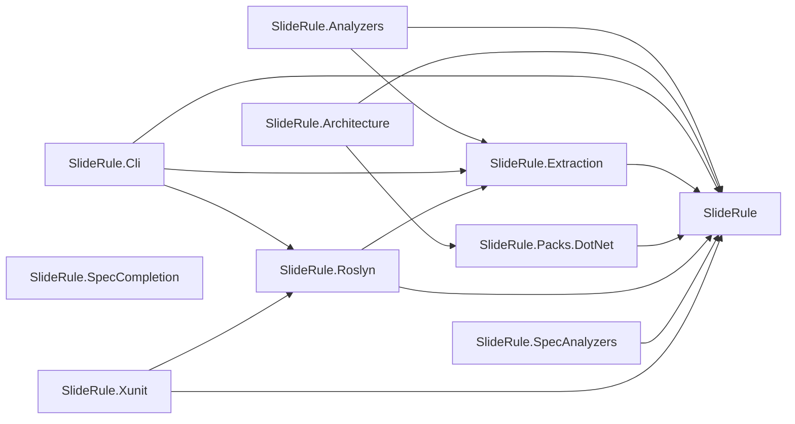
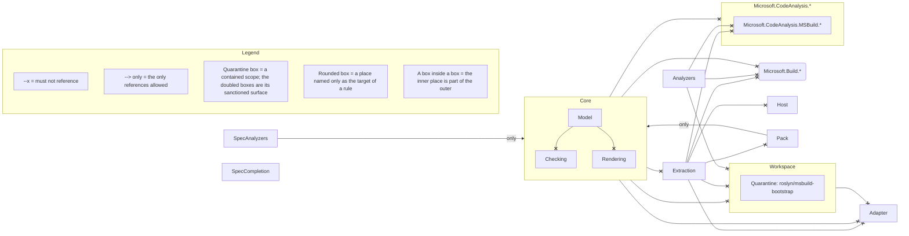

# SlideRule on itself

SlideRule is a .NET architecture checker, and it governs itself. Its spec, [`SlideRuleArchitectureSpec.cs`](https://github.com/andypgray/sliderule/blob/main/arch/SlideRule.Architecture/SlideRuleArchitectureSpec.cs), states 49 rules over this repository's real code, across 12 declared layers. That rule count includes the spec's one [quarantined scope](https://github.com/andypgray/sliderule/blob/main/WRITING-SPECS.md#scopes) and leaves out its Caution scope, which only warns. A `check` run counts more rules, because it runs the quarantine as a containment rule and a tripwire, and the Caution scope as a tripwire. Each fence on this page shows that spec, or this solution under it, on one surface after another. The fences under [As SARIF](#as-sarif) are the exception, because showing a ratchet needs live debt and this repository has paid its own off. They come from the Meridian example. The section [Why these excerpts can be trusted](#why-these-excerpts-can-be-trusted) explains how each fence on this page is checked or registered.

## This repo's own spec

Take the rule that keeps the CLI off stdout. `host` is the layer declared as `arch.Layer("Host", arch.Project("SlideRule.Cli"))`, which is every type in the CLI project:

```csharp
        arch.Rule("cli/no-stdout")
            .Enforce(host
                .MustNotUse(
                    arch.Member(() => Console.Out),
                    arch.Member(typeof(Console), nameof(Console.Write)),
                    arch.Member(() => Console.WriteLine())))
            .Because("Stdout is a protocol channel here — the MCP server speaks JSON-RPC over it and CLI " +
                     "output flows through System.CommandLine's console — so a direct Console write corrupts " +
                     "the wire and is invisible to the in-process tests.")
            .Citation("https://modelcontextprotocol.io/specification/2025-06-18/basic/transports#stdio")
            .Fix("Write CLI output through the command's InvocationConfiguration console; route server " +
                 "diagnostics to the logger or Console.Error.");
```

Each of the three `arch.Member` forms names a member by its declaring type and its name. A ban covers every overload of that name, `Console.WriteLine("x")` included. `Console.Write` is named by type and name because the expression form needs a call it can compile, and `Write` has no overload without arguments.

The compiler accepts a `Console.WriteLine` anywhere in the CLI, while the MCP server speaks JSON-RPC over that same stdout. A stray write that runs in the server corrupts the protocol, and this rule fails the check as soon as one is in the code.

## The prose it generates

`sliderule render` derives the rule sentence from the constraint and copies the `Because` word for word. It writes the result into the managed block of this repository's committed [`AGENTS.md`](https://github.com/andypgray/sliderule/blob/main/AGENTS.md), the file [coding agents read](https://github.com/andypgray/sliderule/blob/main/CODING-AGENTS.md#the-context-files):

```markdown
- `cli/no-stdout` — The Host layer must not use `Console.Out`, `Console.Write()` or `Console.WriteLine()`. Stdout is a protocol channel here — the MCP server speaks JSON-RPC over it and CLI output flows through System.CommandLine's console — so a direct Console write corrupts the wire and is invisible to the in-process tests. See <https://modelcontextprotocol.io/specification/2025-06-18/basic/transports#stdio>.
```

The renderer wrote that sentence from the spec. The test [`SelfSpecTests.AgentsMd_IsCurrent`](https://github.com/andypgray/sliderule/blob/main/tests/SlideRule.Tests/Dogfood/SelfSpecTests.cs) composes the block in process and fails unless the committed block already equals it. Its sibling `ScopedCards_AreCurrent` checks every per-directory card this repository commits the same way. It also fails on a committed card that no rule placement produced, such as one a spec change left behind. So the prose an agent reads is the spec `check` enforces, and agents that query over MCP (`sliderule mcp`) get the same model.

The block is as current as the CLI that renders it. It records no version, so an older `sliderule` re-renders it to that older tool's content without a warning. Keep the tool at the version of the spec's package reference, as [Operating SlideRule](https://github.com/andypgray/sliderule/blob/main/OPERATING.md#upgrading) explains. Then run `render --check` in [CI](https://github.com/andypgray/sliderule/blob/main/OPERATING.md#ci) to fail on a stale file, as this repository does for itself and for its [examples](https://github.com/andypgray/sliderule/blob/main/README.md#examples).

## When an agent breaks it

Suppose an agent adds a progress printer to the CLI so a slow solution load stops looking hung, and reaches for `Console.WriteLine`. The agent finishes and tries to end its turn. The `Stop` hook in [`hooks/`](https://github.com/andypgray/sliderule/tree/main/hooks) runs `check` over the working tree, and the rule goes red. The hook exits 2, the exit code that blocks a Claude Code stop, and writes the report to stderr, where the agent reads it:

```text
FAIL cli/no-stdout — The Host layer must not use `Console.Out`, `Console.Write()` or `Console.WriteLine()`.
  because: Stdout is a protocol channel here — the MCP server speaks JSON-RPC over it and CLI output flows through System.CommandLine's console — so a direct Console write corrupts the wire and is invisible to the in-process tests.
  citation: https://modelcontextprotocol.io/specification/2025-06-18/basic/transports#stdio
  fix: Write CLI output through the command's InvocationConfiguration console; route server diagnostics to the logger or Console.Error.
  subject: 196 types, 1 generated
  src/SlideRule.Cli/Rendering/ProgressPrinter.cs:10 — SlideRule.Cli.Rendering.ProgressPrinter uses System.Console.WriteLine()
  src/SlideRule.Cli/Rendering/ProgressPrinter.cs:15 — SlideRule.Cli.Rendering.ProgressPrinter uses System.Console.WriteLine()
```

The hook's report lists every rule, and each red one gets a stanza like this. A stanza gives the agent what it needs to act without asking anyone: the rule ID and its sentence, the reason, the page the reason cites, the fix, and the `file:line` of every offending use. The `subject:` line counts the types the rule covered, and appears only when generated code is among them. The agent moves the output to the command's console, and the next stop passes.

## When a rule reaches a type you did not expect

`explain --type` names every layer, rule and scope that claims a type, and why. An agent asks it when a rule fires somewhere it did not expect, and an author asks it when an exemption seems not to apply. Here is this repository's spec answering for `CommandEntryPoint`, the shell every CLI command runs inside. The excerpt keeps the lines above and below its list of rules:

```text
SlideRule.Cli.CommandEntryPoint (class)
  project: SlideRule.Cli
  file: src/SlideRule.Cli/CommandEntryPoint.cs
  layers:
    Host
      declared by project `SlideRule.Cli`
  excepted by:
    rule exceptions/no-swallowed-broad-catches: Types in the Core, Extraction, Analyzers, SpecAnalyzers, SpecCompletion, Workspace, Host, Adapter or Pack layers, except types named `ArchChecker`, `ArchRuleTests`, `BuildTierAnalyzer`, `CommandEntryPoint`, `IdleTimeoutWatchdog`, `ParentProcessWatcher`, `ServerShutdown`, `SpecLiteralAnalyzer` or `VsWhereLocator`
      in the Host layer
        declared by project `SlideRule.Cli`
      removed by the except: types named `ArchChecker`, `ArchRuleTests`, `BuildTierAnalyzer`, `CommandEntryPoint`, `IdleTimeoutWatchdog`, `ParentProcessWatcher`, `ServerShutdown`, `SpecLiteralAnalyzer` or `VsWhereLocator`
        it is named `CommandEntryPoint`
```

The shell catches every exception so that a failed command prints its error and exits 2. The `excepted by` group shows the exemption that allows the catch, and that it matches on the simple name alone. A second type named `CommandEntryPoint` anywhere in those layers would be exempt as well. Over MCP, `arch_explain` takes the same question as its `type` parameter.

## In xUnit

The same spec runs in a test project. `ArchRuleTests<TSpec>` from the [xUnit adapter](https://github.com/andypgray/sliderule/blob/main/src/SlideRule.Xunit/README.md) turns each rule into a named test, and this repository's use of it is [one class declaration](https://github.com/andypgray/sliderule/blob/main/tests/SlideRule.Tests/Dogfood/AdapterSelfSpecTests.cs):

```csharp
public sealed class AdapterSelfSpecTests : ArchRuleTests<SlideRuleArchitectureSpec>
{
    protected override string SolutionPath => FindSolutionUp("SlideRule.slnx");
}
```

Each test's display name is its rule ID, so the run summary names a broken rule. A `Migrate` rule's test stays green while every violation it finds is in its baseline. The [CI](https://github.com/andypgray/sliderule/blob/main/.github/workflows/ci.yml) workflow runs the class as a step of its own, "Self-spec as named xUnit tests (one test per rule)", and that step's log has a line for each rule ID. The adapter needs an xUnit v3 test project on .NET 10 or later, as its [requirements](https://github.com/andypgray/sliderule/blob/main/src/SlideRule.Xunit/README.md#requirements) list.

## In the build

The [build analyzer](https://github.com/andypgray/sliderule/blob/main/src/SlideRule.Analyzers/README.md) reports a broken rule as a compiler warning at the offending code, in the editor and in `dotnet build`. It reads the rules from the model file `render --model` writes. The four example solutions attach it, and CI's [`examples` job](https://github.com/andypgray/sliderule/blob/main/.github/workflows/ci.yml) builds each of them with the analyzer's six diagnostic IDs promoted to errors. Any diagnostic from the analyzer then fails the job. This repository's own projects take the analyzer package at its last released version, so the committed model file is read by the last release's reader, and CI's [`self-check` job](https://github.com/andypgray/sliderule/blob/main/.github/workflows/ci.yml) builds the solution with the same six IDs as errors. The build decides each rule that one project's compilation can decide. The rest need the whole solution, among them the packaging rules, the front doors and the two tripwires, and stay with `check`.

## As SARIF

`check --sarif` writes the same verdict as SARIF 2.1.0, which is what GitHub code scanning reads. A `Migrate` rule is where that matters most, and this repository no longer has one. Its own ratchet reached zero and was promoted, which is how the recipe is meant to end. So this section's fences come from the [Meridian example](https://github.com/andypgray/sliderule/tree/main/examples/Meridian), a mid-migration monolith moving inline SQL out of its controllers over a counted baseline:

```csharp
        arch.Rule("data-access/no-inline-sql")
            .Migrate(
                from: "Controllers open SqlConnection and run inline SQL directly.",
                to: arch.Namespace("Meridian.Web.Controllers.*")
                    .MustNotReference(typeof(SqlConnection), typeof(SqlCommand)))
            .Because("Data access behind a repository can be tested and swapped; SQL in the request path cannot.")
            .Fix("Move the SQL into a repository.")
            .Exemplar(arch.Types.Named("BookingRepository"));
```

Its 12 baselined violations keep the rule green at the command line, and their sites still reach code scanning as note-level alerts. A reviewer therefore sees the burndown without a build failing. Code scanning shows a result's `level` and message, and acts on neither its suppression nor its baseline state. So each baselined site's message ends with its attribution, which is the baseline entry's reason or, without one, the baseline file. One result object from a fresh run:

```json
{
  "ruleId": "data-access/no-inline-sql",
  "level": "note",
  "message": {
    "text": "Meridian.Web.Controllers.CustomsController references Microsoft.Data.SqlClient.SqlCommand (grandfathered in arch/baselines/data-access/no-inline-sql.json)"
  },
  "locations": [
    {
      "physicalLocation": {
        "artifactLocation": {
          "uri": "src/Meridian.Web/Controllers/CustomsController.cs",
          "uriBaseId": "SRCROOT"
        },
        "region": {
          "startLine": 27
        }
      }
    }
  ],
  "partialFingerprints": {
    "slideRuleViolationIdentity/v1": "v1|T:Meridian.Web.Controllers.CustomsController|T:Microsoft.Data.SqlClient.SqlCommand||src/Meridian.Web/Controllers/CustomsController.cs|0"
  },
  "baselineState": "unchanged",
  "suppressions": [
    {
      "kind": "external",
      "justification": "grandfathered in arch/baselines/data-access/no-inline-sql.json"
    }
  ]
}
```

A violation of a red rule has the same shape at `error` level, with `"baselineState": "new"` and no `suppressions` array. In code scanning a reviewer tells baselined debt from a new violation by severity, and a SARIF consumer that reads `baselineState` or `suppressions` can use either. Reproduce the file from a checkout:

```bash
dotnet build examples/Meridian/Meridian.slnx
sliderule check examples/Meridian/Meridian.slnx --sarif sliderule.sarif
```

CI's [`self-check` job](https://github.com/andypgray/sliderule/blob/main/.github/workflows/ci.yml) runs the same check over this repository's own spec on every pull request and every push to `main`, and uploads the SARIF it writes. A pull request from a fork or from Dependabot skips the upload, because its token cannot write to code scanning.

The same rule from `check --json`, the document `arch_check` returns over MCP, shows the ratchet as counters instead of suppressions:

```json
{
  "id": "data-access/no-inline-sql",
  "posture": "migrate",
  "status": "passed",
  "sentence": "Types in `Meridian.Web.Controllers.*` must not reference `SqlConnection` or `SqlCommand`.",
  "because": "Data access behind a repository can be tested and swapped; SQL in the request path cannot.",
  "fix": "Move the SQL into a repository.",
  "exemplar": [
    {
      "type": "Meridian.Web.Data.BookingRepository",
      "sites": [
        {
          "file": "src/Meridian.Web/Data/BookingRepository.cs",
          "line": 6
        }
      ]
    }
  ],
  "baseline": {
    "path": "arch/baselines/data-access/no-inline-sql.json",
    "grandfathered": 12,
    "stale": 0
  },
  "violationCount": 0,
  "violations": [],
  "warnings": []
}
```

`grandfathered` counts the violations the baseline still covers, where a violation is a controller's use of a SQL type, at however many sites. `stale` counts the entries whose violation is gone and that `sliderule baseline accept-reductions` has yet to remove. When a controller stops using a SQL type, the first count falls and the second rises until the next `accept-reductions`. Once the baseline is empty, the rule can be promoted to `Enforce` and its baseline file deleted. This repository's own ratchet, `mcp/env-through-seam`, ended that way after its rule was narrowed to the environment-variable members, which left out its last two sites.

## The graph

`sliderule graph` surveys the codebase a spec is written against: projects and their references, namespaces and their sizes, and every external dependency by root. It needs no spec. It prints 27 project lines for this solution, one for every project the load reaches, so the projects that test fixtures reference are among them. These are the lines for its ten projects outside the tests and their fixtures:

```text
  SlideRule — 385 types; targets netstandard2.0; references: (none); packages: (none); locks restore
  SlideRule.Analyzers — 11 types; targets netstandard2.0; references: SlideRule, SlideRule.Extraction; packages: Microsoft.CodeAnalysis.Analyzers (private); locks restore
  SlideRule.Architecture — 1 type; targets net10.0; references: SlideRule, SlideRule.Packs.DotNet; packages: Microsoft.Build.Locator; does not pack
  SlideRule.Cli — 195 types (1 generated); targets net10.0; references: SlideRule, SlideRule.Extraction, SlideRule.Roslyn; packages: Microsoft.Extensions.Hosting, ModelContextProtocol, Serilog.Extensions.Hosting, Serilog.Sinks.File, SlideRule.Analyzers (private), System.CommandLine; locks restore
  SlideRule.Extraction — 54 types; targets netstandard2.0; references: SlideRule; packages: Microsoft.CodeAnalysis.CSharp; does not pack; locks restore
  SlideRule.Packs.DotNet — 2 types; targets net10.0; references: SlideRule; packages: Microsoft.Extensions.DependencyInjection, Microsoft.Extensions.DependencyInjection.Abstractions, SlideRule.Analyzers (private); does not pack; locks restore
  SlideRule.Roslyn — 114 types (11 generated); targets net10.0; references: SlideRule, SlideRule.Extraction; packages: Basic.CompilerLog.Util, Microsoft.Build (private), Microsoft.Build.Framework (private), Microsoft.Build.Locator, Microsoft.Build.Tasks.Core (private), Microsoft.Build.Utilities.Core (private), Microsoft.CodeAnalysis, Microsoft.CodeAnalysis.CSharp.Workspaces, Microsoft.CodeAnalysis.Workspaces.MSBuild, Microsoft.NET.StringTools (private), SlideRule.Analyzers (private), System.Security.Cryptography.Xml (private); does not pack; locks restore
  SlideRule.SpecAnalyzers — 5 types; targets netstandard2.0; references: SlideRule; packages: Microsoft.CodeAnalysis.Analyzers (private), Microsoft.CodeAnalysis.CSharp (private), SlideRule.Analyzers (private); does not pack; locks restore
  SlideRule.SpecCompletion — 13 types; targets netstandard2.0; references: (none); packages: Microsoft.CodeAnalysis.Analyzers (private), Microsoft.CodeAnalysis.CSharp (private), Microsoft.CodeAnalysis.Features (private), SlideRule.Analyzers (private); does not pack; locks restore
  SlideRule.Xunit — 3 types; targets net10.0; references: SlideRule, SlideRule.Roslyn; packages: Basic.CompilerLog.Util, Microsoft.Build.Framework (private), Microsoft.Build.Locator, Microsoft.Build.Utilities.Core (private), Microsoft.CodeAnalysis, Microsoft.CodeAnalysis.CSharp.Workspaces, Microsoft.CodeAnalysis.Workspaces.MSBuild, Microsoft.NET.StringTools (private), SlideRule.Analyzers (private), xunit.v3.assert, xunit.v3.extensibility.core; locks restore
```

The `references: (none)` on the first line is the rule `layering/core-no-roslyn` seen from the other side. That rule forbids Core, the model every spec compiles to, from referencing the Roslyn project or the compiler packages, and the survey shows Core referencing no project at all. The count of generated types in parentheses is worth checking before writing a rule on a project, because `arch.Project` selects everything the assembly declares, generated files included. On a web project where compiled views outnumber the code around them, that number shows whether a project rule would mostly judge generated code. `locks restore` and `does not pack` are facts the packaging rules judge. A rule can check a project's target frameworks, package references and lock file as well as its types, as [Writing specs](https://github.com/andypgray/sliderule/blob/main/WRITING-SPECS.md#what-a-rule-covers) shows.

`render --diagram <path>` draws that same survey as a Mermaid diagram inside a committed file's managed block. Pointed at this repository and scoped to the projects shown above, it writes [`ARCHITECTURE.md`](https://github.com/andypgray/sliderule/blob/main/ARCHITECTURE.md):



A solid arrow is a reference some type makes. A dotted arrow would be a project reference that is declared and never used, which the text survey shows only when two of its sections are read against each other. The drawing has no dotted arrows, so every project reference here is used. The test [`SelfSpecTests.ArchitectureMd_IsCurrent`](https://github.com/andypgray/sliderule/blob/main/tests/SlideRule.Tests/Dogfood/SelfSpecTests.cs) fails when the committed drawing differs from what the code gives, as `AgentsMd_IsCurrent` does for the block above.

That drawing comes from what the code does. The same block has a second one, drawn from what the spec forbids:



The renderer takes every shape in that drawing from the spec. A bare `--x` is a reference the spec forbids, and an arrow labelled `only` points at the only places a layer may reference. The node `Quarantine: roslyn/msbuild-bootstrap` inside Workspace is the quarantined scope. Its sanctioned surface, `MsBuildBootstrap`, is selected by name, which the drawing cannot place. So no doubled box appears, and the scope's containment rule is listed under the drawing. The spec declares Model, Checking and Rendering as namespaces inside the Core project, so the drawing nests them inside Core. The legend is generated too, with one row for each kind of mark the drawing uses. In this drawing a dotted arrow would be a `Migrate` rule's ban, labelled `grandfathered` and explained by a legend row of its own, as in [Meridian's drawing](https://github.com/andypgray/sliderule/blob/main/examples/Meridian/ARCHITECTURE.md). This spec has no `Migrate` rule left, so neither appears.

`ARCHITECTURE.md` has one more line under that drawing, listing by ID every rule the drawing cannot place in full. Most are rules about names, shapes, attributes and members, which have no arrow to draw. The others include rules with no single direction, such as the ban on circular references, and the scopes' tripwires. `sliderule explain <rule-id>` expands any of them.

## Why these excerpts can be trusted

Each fence that quotes a file or a tool's output is checked against its source by a test that fails when the two differ. [`QuoteSyncTests`](https://github.com/andypgray/sliderule/blob/main/tests/SlideRule.Tests/DocHygiene/QuoteSyncTests.cs) compares each quoted excerpt with the committed file it was cut from: both rules with their whole statements, the `AGENTS.md` line with that file, the two drawings with `ARCHITECTURE.md`, and the adapter class with its test file. Change the spec and leave this page alone, and the suite goes red. The build commands under [As SARIF](#as-sarif) are registered as commands, since they quote no file. `QuoteSyncTests` also fails on any fence on this page that no registry names. The hook report, the `explain --type` answer, the SARIF object, the check document and the graph survey are captured output. Each is registered in [`CapturedFences`](https://github.com/andypgray/sliderule/blob/main/tests/SlideRule.Tests/DocHygiene/CapturedFences.cs) with the test that runs the tool again. Each line of the `explain --type` excerpt must be a line of that run, in order. When an output no longer matches its run, that test fails and prints the text to paste in its place.

The test [`ReadmeAnchorGateTests`](https://github.com/andypgray/sliderule/blob/main/tests/SlideRule.Tests/DocHygiene/ReadmeAnchorGateTests.cs) resolves each `file:line` in a quoted report against the source it names. The two `ProgressPrinter.cs` lines are the exception, here and on the README, because that file is the change the agent was imagined to make. The hook report's test compiles it into the CLI project in memory, and the anchor test fails the day a committed file matches those lines.

Other tests check the counts in the prose. The rule count in the first paragraph is checked against the `AGENTS.md` block, the layer count against the spec, the project-line count against the survey, and the baseline size under [As SARIF](#as-sarif) against Meridian's committed baseline. The rule sentence on the hook report's `FAIL` line is checked against the `AGENTS.md` block too. The README's fences are registered the same way. Its starter rule is checked against the whole statement it is cut from in the example spec. Its hook report is checked against the same run as this page's, and its .NET Framework check is run again on Windows. Every one of these tests runs in [CI](https://github.com/andypgray/sliderule/actions/workflows/ci.yml) on each pull request and each push to `main`.
