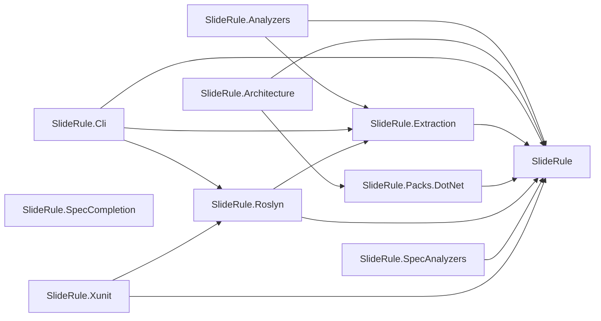
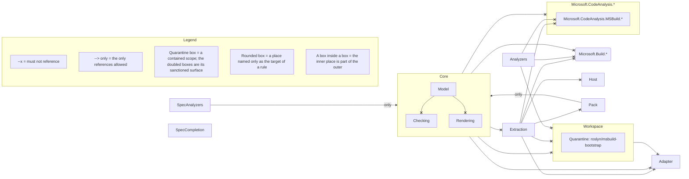

# SlideRule on itself

SlideRule is a .NET architecture checker, and it governs itself. Forty-one rules over this repository's real code, across twelve declared layers, live in [`SlideRuleArchitectureSpec.cs`](https://github.com/andypgray/sliderule/blob/main/arch/SlideRule.Architecture/SlideRuleArchitectureSpec.cs). Every fence on this page is that spec, or this solution under it, on one surface after another. The fences under [As SARIF](#as-sarif) are the exception. They come from the Meridian example, because showing a ratchet needs live debt and this repository has paid its own off. The section [Why these excerpts can be trusted](#why-these-excerpts-can-be-trusted) says which tests hold every fence on this page.

## This repo's own spec

Take the rule that keeps the CLI off stdout. `host` is the layer the CLI project defines:

```csharp
        arch.Rule("cli/no-stdout")
            .Enforce(host
                .MustNotUse(
                    arch.Member(() => Console.Out),
                    arch.Member(typeof(Console), nameof(Console.Write)),
                    arch.Member(() => Console.WriteLine())))
            .Because("Stdout is a protocol channel here — the MCP server speaks JSON-RPC over it and CLI " +
                     "output flows through System.CommandLine's console — so a direct Console write corrupts " +
                     "the wire and is invisible to the in-process tests.")
            .Citation("https://modelcontextprotocol.io/specification/2025-06-18/basic/transports#stdio")
            .Fix("Write CLI output through the command's InvocationConfiguration console; route server " +
                 "diagnostics to the logger or Console.Error.");
```

Nothing in the build system stops the CLI writing to `Console`. The MCP server on the other side of that stdout speaks JSON-RPC over it. This rule is the only thing standing between those two facts.

## The prose it generates

`sliderule render` derives the rule sentence from the constraint and carries the `Because` across verbatim. It writes the result into the managed block of this repository's committed [`AGENTS.md`](https://github.com/andypgray/sliderule/blob/main/AGENTS.md), the file [coding agents read](https://github.com/andypgray/sliderule/blob/main/CODING-AGENTS.md#the-context-files):

```markdown
- `cli/no-stdout` — The Host layer must not use `Console.Out`, `Console.Write()` or `Console.WriteLine()`. Stdout is a protocol channel here — the MCP server speaks JSON-RPC over it and CLI output flows through System.CommandLine's console — so a direct Console write corrupts the wire and is invisible to the in-process tests. See <https://modelcontextprotocol.io/specification/2025-06-18/basic/transports#stdio>.
```

Nobody wrote that sentence, and nobody can let it go stale. The test [`SelfSpecTests.AgentsMd_IsCurrent`](https://github.com/andypgray/sliderule/blob/main/tests/SlideRule.Tests/Dogfood/SelfSpecTests.cs) composes the block in process and asserts the committed file already equals it. Its sibling `ScopedCards_AreCurrent` holds every per-directory card this repository commits the same way. It also fails on a card that no rule placement produced, so one orphaned by a spec change cannot stay behind being read. The prose an agent reads is provably the spec the build enforces. Agents that query over MCP (`sliderule mcp`) get the same model.

The block is as current as the CLI that renders it. Nothing inside it records a version, so an older `sliderule` re-renders it to that older tool's content without warning. Keep the tool and the spec's package reference in lockstep; the README covers that under [Installing](https://github.com/andypgray/sliderule/blob/main/README.md#installing). Re-render in CI to fail on a diff, the way this repository does for its [examples](https://github.com/andypgray/sliderule/blob/main/README.md#examples).

## When an agent breaks it

Suppose an agent adds a progress printer to the CLI so a slow solution load stops looking hung, and reaches for `Console.WriteLine`. The agent finishes and tries to hand the work back. The `Stop` hook in [`hooks/`](https://github.com/andypgray/sliderule/tree/main/hooks) runs `check` over the working tree, and the rule goes red. The hook exits 2, which is how a Claude Code hook refuses a stop, with the report on the agent's stderr:

```text
FAIL cli/no-stdout — The Host layer must not use `Console.Out`, `Console.Write()` or `Console.WriteLine()`.
  because: Stdout is a protocol channel here — the MCP server speaks JSON-RPC over it and CLI output flows through System.CommandLine's console — so a direct Console write corrupts the wire and is invisible to the in-process tests.
  citation: https://modelcontextprotocol.io/specification/2025-06-18/basic/transports#stdio
  fix: Write CLI output through the command's InvocationConfiguration console; route server diagnostics to the logger or Console.Error.
  subject: 191 types, 1 generated
  src/SlideRule.Cli/Rendering/ProgressPrinter.cs:10 — SlideRule.Cli.Rendering.ProgressPrinter uses System.Console.WriteLine()
  src/SlideRule.Cli/Rendering/ProgressPrinter.cs:15 — SlideRule.Cli.Rendering.ProgressPrinter uses System.Console.WriteLine()
```

That stanza is one rule's worth of the board the hook hands back whole. It carries the five things an agent needs to act without asking a human. They are the rule ID, the reason, the page that reason rests on, the fix, and the exact `file:line` of every offending write. The `subject:` line is scope, not a finding, and appears only when a generator wrote some of what the rule swept. The agent routes the output through the command's console instead, and the next stop is clean.

## When a rule reaches a type you did not expect

`explain --type` names every layer, rule and scope that claims a type, and why. An agent asks it when a rule fires somewhere it did not expect, and an author asks it when an exemption seems not to hold. Here is this repository's spec answering for `CommandEntryPoint`, the shell every CLI command runs inside. The excerpt keeps the lines above and below its list of rules:

```text
SlideRule.Cli.CommandEntryPoint (class)
  project: SlideRule.Cli
  file: src/SlideRule.Cli/CommandEntryPoint.cs
  layers:
    Host
      declared by project `SlideRule.Cli`
  excepted by:
    rule exceptions/no-swallowed-broad-catches: Types in the Core, Extraction, Analyzers, SpecAnalyzers, SpecCompletion, Workspace, Host, Adapter or Pack layers, except types named `ArchChecker`, `ArchRuleTests`, `BuildTierAnalyzer`, `CommandEntryPoint`, `IdleTimeoutWatchdog`, `ParentProcessWatcher`, `ServerShutdown`, `SpecLiteralAnalyzer` or `VsWhereLocator`
      in the Host layer
        declared by project `SlideRule.Cli`
      removed by the except: types named `ArchChecker`, `ArchRuleTests`, `BuildTierAnalyzer`, `CommandEntryPoint`, `IdleTimeoutWatchdog`, `ParentProcessWatcher`, `ServerShutdown`, `SpecLiteralAnalyzer` or `VsWhereLocator`
        it is named `CommandEntryPoint`
```

The shell catches every exception so that a failed command prints its error and exits 2. The `excepted by` group shows the exemption that allows the catch, and that it matches on the simple name alone. A second type named `CommandEntryPoint` anywhere in those layers would be exempt as well. Over MCP, `arch_explain` takes the same question as its `type` parameter.

## In xUnit

The same spec runs inside a test project, where a team already looks. `ArchRuleTests<TSpec>` from the xUnit adapter turns each rule into an individually named test, and this repository's whole adapter dogfood is [one class declaration](https://github.com/andypgray/sliderule/blob/main/tests/SlideRule.Tests/Dogfood/AdapterSelfSpecTests.cs):

```csharp
public sealed class AdapterSelfSpecTests : ArchRuleTests<SlideRuleArchitectureSpec>
{
    protected override string SolutionPath => FindSolutionUp("SlideRule.slnx");
}
```

Each test's display name is its rule ID, so a broken rule is named in the run summary rather than buried in an assertion message. A `Migrate` rule's grandfathered sites keep their test green while the ratchet holds. The [CI](https://github.com/andypgray/sliderule/blob/main/.github/workflows/ci.yml) workflow runs the class as a step of its own, "Self-spec as named xUnit tests (one test per rule)". That step's log carries one line per rule ID.

## As SARIF

`check --sarif` writes the same verdict as SARIF 2.1.0, which is what GitHub code scanning reads. A `Migrate` rule is where that matters most, and this repository no longer has one. Its own ratchet reached zero and was promoted, which is how the recipe is meant to end. So this section's fences come from the [Meridian example](https://github.com/andypgray/sliderule/tree/main/examples/Meridian), a mid-migration monolith retiring inline SQL out of its controllers over a counted baseline:

```csharp
        arch.Rule("data-access/no-inline-sql")
            .Migrate(
                from: "Controllers open SqlConnection and run inline SQL directly.",
                to: arch.Namespace("Meridian.Web.Controllers.*")
                    .MustNotReference(typeof(SqlConnection), typeof(SqlCommand)))
            .Because("Data access behind a repository can be tested and swapped; SQL in the request path cannot.")
            .Fix("Move the SQL into a repository.")
            .Exemplar(arch.Types.Named("BookingRepository"));
```

Its twelve baselined sites keep the rule green at the command line and still reach code scanning as note-level alerts. The burndown is then visible to anyone reviewing, without ever failing a build. Code scanning reads a result's `level` and message and ignores both the suppression and the baseline state. So each site repeats its baseline attribution in the message, which is the line the alert shows. One result object from a fresh run:

```json
{
  "ruleId": "data-access/no-inline-sql",
  "level": "note",
  "message": {
    "text": "Meridian.Web.Controllers.CustomsController references Microsoft.Data.SqlClient.SqlCommand (grandfathered in arch/baselines/data-access/no-inline-sql.json)"
  },
  "locations": [
    {
      "physicalLocation": {
        "artifactLocation": {
          "uri": "src/Meridian.Web/Controllers/CustomsController.cs",
          "uriBaseId": "SRCROOT"
        },
        "region": {
          "startLine": 27
        }
      }
    }
  ],
  "partialFingerprints": {
    "slideRuleViolationIdentity/v1": "v1|T:Meridian.Web.Controllers.CustomsController|T:Microsoft.Data.SqlClient.SqlCommand||src/Meridian.Web/Controllers/CustomsController.cs|0"
  },
  "baselineState": "unchanged",
  "suppressions": [
    {
      "kind": "external",
      "justification": "grandfathered in arch/baselines/data-access/no-inline-sql.json"
    }
  ]
}
```

A rule that is red lands the same shape at `error` level, with `"baselineState": "new"` and no `suppressions` array. In code scanning a reviewer tells house debt from a fresh breach by severity; a consumer that honours `baselineState` or `suppressions` can use either. Reproduce the file from a checkout:

```bash
dotnet build examples/Meridian/Meridian.slnx
sliderule check examples/Meridian/Meridian.slnx --sarif sliderule.sarif
```

CI's [`self-check` job](https://github.com/andypgray/sliderule/blob/main/.github/workflows/ci.yml) runs the same check over this repository's own spec on every push and uploads the SARIF it writes.

The same rule from `check --json`, the document `arch_check` returns over MCP, shows the ratchet as counters instead of suppressions:

```json
{
  "id": "data-access/no-inline-sql",
  "posture": "migrate",
  "status": "passed",
  "sentence": "Types in `Meridian.Web.Controllers.*` must not reference `SqlConnection` or `SqlCommand`.",
  "because": "Data access behind a repository can be tested and swapped; SQL in the request path cannot.",
  "fix": "Move the SQL into a repository.",
  "exemplar": [
    {
      "type": "Meridian.Web.Data.BookingRepository",
      "sites": [
        {
          "file": "src/Meridian.Web/Data/BookingRepository.cs",
          "line": 6
        }
      ]
    }
  ],
  "baseline": {
    "path": "arch/baselines/data-access/no-inline-sql.json",
    "grandfathered": 12,
    "stale": 0
  },
  "violationCount": 0,
  "violations": [],
  "warnings": []
}
```

Both counters go to zero when the last controller moves its SQL behind a repository. The rule is then narrowed to what it actually meant, promoted to `Enforce`, and its baseline file deleted. That is what happened to this repository's own ratchet. The MCP infrastructure had migrated its environment reads to the `IEnvironment` seam, leaving two baselined sites the seam could not take. So the law was narrowed to the environment-variable members it was always about, and the baseline file went with it.

## The graph

`sliderule graph` surveys the codebase a spec is written against: projects and their references, namespaces and their sizes, every external dependency by root. It prints twenty-seven project lines for this solution. These are the lines for its ten projects outside the tests and their fixtures:

```text
  SlideRule — 363 types; targets netstandard2.0; references: (none); packages: (none); locks restore
  SlideRule.Analyzers — 11 types; targets netstandard2.0; references: SlideRule, SlideRule.Extraction; packages: Microsoft.CodeAnalysis.Analyzers (private); locks restore
  SlideRule.Architecture — 1 type; targets net10.0; references: SlideRule, SlideRule.Packs.DotNet; packages: Microsoft.Build.Locator; does not pack
  SlideRule.Cli — 190 types (1 generated); targets net10.0; references: SlideRule, SlideRule.Extraction, SlideRule.Roslyn; packages: Microsoft.Extensions.Hosting, ModelContextProtocol, Serilog.Extensions.Hosting, Serilog.Sinks.File, System.CommandLine; locks restore
  SlideRule.Extraction — 51 types; targets netstandard2.0; references: SlideRule; packages: Microsoft.CodeAnalysis.CSharp; does not pack; locks restore
  SlideRule.Packs.DotNet — 2 types; targets net10.0; references: SlideRule; packages: Microsoft.Extensions.DependencyInjection, Microsoft.Extensions.DependencyInjection.Abstractions; does not pack; locks restore
  SlideRule.Roslyn — 104 types (11 generated); targets net10.0; references: SlideRule, SlideRule.Extraction; packages: Basic.CompilerLog.Util, Microsoft.Build (private), Microsoft.Build.Framework (private), Microsoft.Build.Locator, Microsoft.Build.Tasks.Core (private), Microsoft.Build.Utilities.Core (private), Microsoft.CodeAnalysis, Microsoft.CodeAnalysis.CSharp.Workspaces, Microsoft.CodeAnalysis.Workspaces.MSBuild, Microsoft.NET.StringTools (private), System.Security.Cryptography.Xml (private); does not pack; locks restore
  SlideRule.SpecAnalyzers — 5 types; targets netstandard2.0; references: SlideRule; packages: Microsoft.CodeAnalysis.Analyzers (private), Microsoft.CodeAnalysis.CSharp (private); does not pack; locks restore
  SlideRule.SpecCompletion — 13 types; targets netstandard2.0; references: (none); packages: Microsoft.CodeAnalysis.Analyzers (private), Microsoft.CodeAnalysis.CSharp (private), Microsoft.CodeAnalysis.Features (private); does not pack; locks restore
  SlideRule.Xunit — 3 types; targets net10.0; references: SlideRule, SlideRule.Roslyn; packages: Basic.CompilerLog.Util, Microsoft.Build.Framework (private), Microsoft.Build.Locator, Microsoft.Build.Utilities.Core (private), Microsoft.CodeAnalysis, Microsoft.CodeAnalysis.CSharp.Workspaces, Microsoft.CodeAnalysis.Workspaces.MSBuild, Microsoft.NET.StringTools (private), xunit.v3.assert, xunit.v3.extensibility.core; locks restore
```

The `references: (none)` on the first line is `layering/core-no-roslyn` seen from the other side. The rule forbids the reified model from reaching for the Roslyn project or the compiler packages behind it. The survey shows it reaching for no other project in the solution. The count of generated types in parentheses is the one to check before writing a rule on a project. `arch.Project` names everything the assembly declares, generated files included. On a web tier where compiled views outnumber the code around them, that number shows whether a project rule would mostly judge generated code. `locks restore` and `does not pack` are the facts the packaging rules judge, so a project's line already shows what those rules read.

`render --diagram <path>` draws that same survey as a Mermaid diagram inside a committed file's managed block. Pointed at this repository and scoped to the projects shown above, it writes [`ARCHITECTURE.md`](https://github.com/andypgray/sliderule/blob/main/ARCHITECTURE.md):



A solid arrow is a reference some type actually makes. A dotted arrow is a project reference that is declared and never exercised. The text survey leaves you to work that out by reading two of its sections against each other. There are no dotted arrows above, so no project here declares a reference it never uses. Nobody drew that diagram either. The test [`SelfSpecTests.ArchitectureMd_IsCurrent`](https://github.com/andypgray/sliderule/blob/main/tests/SlideRule.Tests/Dogfood/SelfSpecTests.cs) holds it the way `AgentsMd_IsCurrent` holds the block above. A hand-drawn architecture diagram is the artifact that rots first; this one is held to the code the same way the rules are.

That fence is drawn from what the code does. The same block carries a second one, drawn from what the spec forbids:



Nothing in that drawing is a shape somebody chose for it. A bare `--x` is a reference this spec forbids, and the labelled arrows are the verbs that need naming. The box holding a doubled node is the quarantined scope with its sanctioned surface. The spec defines Model, Checking and Rendering as namespace cones inside the Core layer, so the drawing nests them inside Core. The legend is generated with the rest, one row per construct this particular drawing uses. A `Migrate` rule would draw a dotted arrow and add a legend row for it, but this spec has none left, so neither appears.

`ARCHITECTURE.md` carries one more line under that fence, for the rules not drawn in full. A diagram can only draw a rule whose subject and targets are *places*. Most of this spec's rules are about shapes, names, attributes and members instead. Those rules are listed by ID, so the picture is never mistaken for the whole law.

## Why these excerpts can be trusted

The excerpts on this page are under gate. The [`QuoteSyncTests`](https://github.com/andypgray/sliderule/blob/main/tests/SlideRule.Tests/DocHygiene/QuoteSyncTests.cs) gate holds each quoted excerpt to the committed file it was cut from. Each of the two rules must equal its whole statement there, line for line. The `AGENTS.md` line must appear in that file verbatim. The gate holds the two drawings to `ARCHITECTURE.md` whole, line for line, and the adapter class to its test file from the attribute line down. Change the spec and leave this page alone, and the suite goes red. A second gate, [`ReadmeAnchorGateTests`](https://github.com/andypgray/sliderule/blob/main/tests/SlideRule.Tests/DocHygiene/ReadmeAnchorGateTests.cs), resolves the `file:line` anchors inside the quoted reports against the sources they name. The two `ProgressPrinter.cs` lines in the hook report are the exception, here and on the README. That file is the change the agent is imagined to have made. So the gate pins those lines as a demonstration and fails the day they match committed code.

Five fences here are captured tool output (the hook report, the claims answer, the SARIF object, the check document and the graph survey). Each one is registered in [`CapturedFences`](https://github.com/andypgray/sliderule/blob/main/tests/SlideRule.Tests/DocHygiene/CapturedFences.cs) with the test that runs the tool again. The hook report's test compiles the imagined `ProgressPrinter.cs` into the CLI project in memory and checks that project. The claims answer comes from `explain --type` over this solution, and each line it quotes must be a line of that run, in order. The SARIF object and the check document come from `check` over a built Meridian, and the graph survey from `graph` over this solution. When a fence stops matching its run, the test fails and prints the text to paste in its place. The build commands under [As SARIF](#as-sarif) quote nothing, so they are registered as commands. `QuoteSyncTests` fails on any fence on this page that nothing registers.

Other tests hold the prose around the fences. The rule count in the first line and the `FAIL` line's sentence are held to this repository's committed `AGENTS.md` block. The baseline size under [As SARIF](#as-sarif) is held to Meridian's committed baseline file. The fences on the [README](https://github.com/andypgray/sliderule/blob/main/README.md) are held too. Its starter rule is held to the whole statement it is cut from in the example spec. Its hook report is held to the same run as this page's. Its Framework check is re-run on Windows, and each line it quotes must be a line of that run, in order.

The page is the tool's output, and [CI](https://github.com/andypgray/sliderule/actions/workflows/ci.yml) is what keeps it that way.
