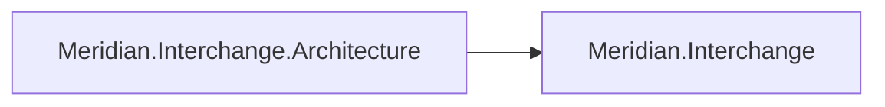
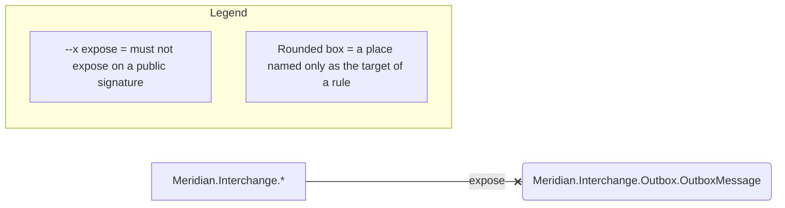

# Architecture: Meridian.Interchange

This page has two drawings of the same worker, both written by `sliderule render`, and it is the
thinnest pair in the example set. Of Meridian.Interchange's 12 rules, 11 have no arrow to draw, and
the drawing is complete. Canonical .NET guidance is almost entirely non-spatial. It tells you to
reuse an `HttpClient`, to accept a `CancellationToken` and to suffix a `Task`-returning method with
`Async`. It also tells you to take services from the container and to keep a scoped dependency out
of a singleton. Every one of those is about how a type is built, called or named.

The law fence has an arrow for two kinds of rule, a reference rule and an exposure rule. Each
arrow runs between two places, each a namespace, a project, a layer or a type named as a target. Among
the 11, ten use a verb the drawing has no arrow for: construct, use, inject, swallow, attributed
with, and the two verbs on methods. The 11th, `di/hosted-services-scope-their-work`, is a reference
rule. Its subject is every type derived from `BackgroundService`, and a set picked by base class is
not a place.

The list under the fence names the other 11 rules, and `sliderule explain <rule-id>` prints any of
the 12 in full.

<!-- sliderule:begin -->
*Generated by `sliderule render` from `Meridian.Interchange.slnx` — do not edit between the markers; re-render to update.*



*Generated by `sliderule render` from `Meridian.Interchange.Architecture`. Do not edit between the markers; edit the spec and re-render.*



Not drawn in full: `di/construct-via-container`, `http/reuse-httpclient`, `di/no-service-locator`, `di/no-buildserviceprovider`, `async/no-sync-over-async` (Migrate), `di/hosted-services-scope-their-work`, `di/no-captive-dependencies`, `naming/async-suffix`, `exceptions/no-general-catch`, `async/accept-cancellation`, `persistence/no-mapping-attributes`. Expand any of them with `sliderule explain <rule-id>`.
<!-- sliderule:end -->

The one rule with a direction is `contracts/no-entity-exposure`, and it is the only rule drawn
inside the fence. `OutboxMessage` is a persisted entity, and the rule bans every public signature
outside the `Outbox` namespace from exposing it. That is a relation between two places, so it
draws, as an `expose` arrow from the subsystem to the type it must keep to itself. The rounded box
marks a place named only as the target of a rule, which is what `OutboxMessage` is here. The rule
names the type as a target, and the type's own members are outside the rule.

Nine of the 11 rules the list names come from a shared rule pack, and `explain` prints each rule's
reason with the learn.microsoft.com page behind it.

To redraw both from a checkout:

```bash
dotnet build examples/Meridian.Interchange/Meridian.Interchange.slnx
sliderule render examples/Meridian.Interchange/Meridian.Interchange.slnx \
  --diagram examples/Meridian.Interchange/ARCHITECTURE.md
```
