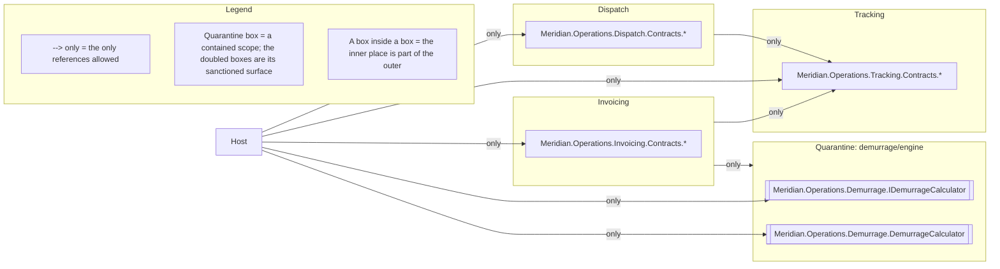

# Architecture: Meridian.Operations

Two drawings of the same subsystem, both written by `sliderule render` rather than by hand, and
they do not look alike. The survey has two nodes. The law fence has ten.

That asymmetry is the point of this page. Meridian.Operations is one web project with five
modules, and only the first of those two facts appears in a project file. The modules are namespace
subtrees inside a single assembly, and the survey is drawn from projects and the references between
them. The survey's finest grain is therefore the project. The law fence is drawn from the spec, and
the spec names the modules. The law fence is the module map.

<!-- sliderule:begin -->
*Generated by `sliderule render` from `Meridian.Operations.slnx` — do not edit between the markers; re-render to update.*


*Generated by `sliderule render` from `Meridian.Operations.Architecture`. Do not edit between the markers; edit the spec and re-render.*



Not drawn in full: `modules/internals`, `modules/tracking/outbound`, `modules/tracking/event-naming`, `demurrage/engine/tripwire` (Quarantine). Expand any of them with `sliderule explain <rule-id>`.
<!-- sliderule:end -->

Every arrow in the law fence is an `only` arrow, which is how a module graph is written here. A
module lists the places it may reach, and everything unlisted is forbidden. `Dispatch` reaches only
`Tracking.Contracts`. `Invoicing` reaches `Tracking.Contracts` and the demurrage scope. `Host` is the
composition root, so it reaches all three `Contracts` surfaces plus the demurrage calculator facade.
No arrow leaves the quarantine box, because Demurrage has no outbound rule and its code references
no other module. Each `Contracts` box is drawn inside its module because that is where it lives. The
inner box is part of the outer one.

The graph is acyclic because none of those allow-lists points back, and the drawing is where that is
easiest to check. Follow the arrows from any box and no path leads back to it.

Two of the rules listed under the fence are about the module graph, and they are the interesting
half of that list. `modules/tracking/outbound` is `tracking.MustOnlyReferenceItself()`, which is how
this language spells "tracking is the leaf". A rule's subject is always among its own permitted
targets, so the leaf form takes no argument. `modules/internals` is one rule over the three modules,
`arch.Each(dispatch, tracking, invoicing)` with their `Contracts` surfaces excepted and
`.MustOnlyBeReferencedByItself()` as the verb. The rule means that each module's interior may be
referenced only from inside that same module. In both rules, the only place an arrow could reach is
the subject itself. The leaf names no target, and the family's far end is a different module for
every cell. `render` lists both under the fence, so every rule in this spec is either drawn or
listed.

The other two have no arrow to draw either. `modules/tracking/event-naming` is about a type shape,
and the quarantine's tripwire warns when a change edits the demurrage engine.

To redraw both from a checkout:

```bash
dotnet build examples/Meridian.Operations/Meridian.Operations.slnx
sliderule render examples/Meridian.Operations/Meridian.Operations.slnx \
  --diagram examples/Meridian.Operations/ARCHITECTURE.md
```
