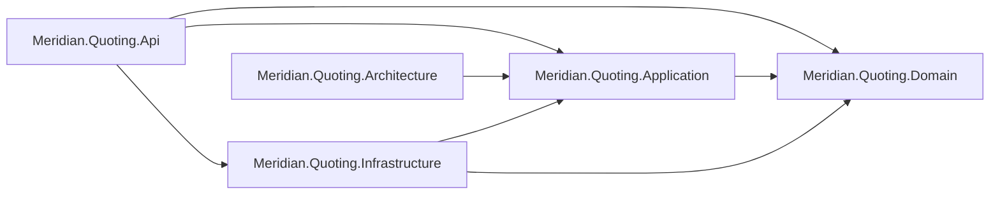
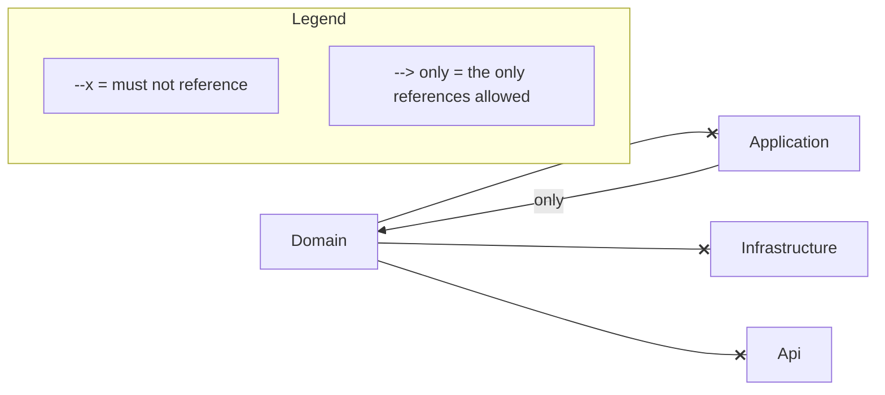

# Architecture: Meridian.Quoting

This page has two drawings of the same subsystem, both written by `sliderule render`. The first is
the codebase survey, drawn from what the code does. It shows the four projects, the spec project,
and the references between them. The second is the architecture law, drawn from the spec.

This is the tidiest law in the example set, and its drawing shows little of that law. The two
facts are consistent, and the pair of drawings is there to show why.

<!-- sliderule:begin -->
*Generated by `sliderule render` from `Meridian.Quoting.slnx` — do not edit between the markers; re-render to update.*



*Generated by `sliderule render` from `Meridian.Quoting.Architecture`. Do not edit between the markers; edit the spec and re-render.*



Not drawn in full: `naming/interfaces`, `naming/controllers`, `handlers/naming`, `handlers/transactional`, `persistence/repository-ports`, `messaging/immutable-messages`, `time/injected-clock`. Expand any of them with `sliderule explain <rule-id>`.
<!-- sliderule:end -->

This subsystem has nine rules and two of them have an arrow to draw. `layering/domain-independent`
is the three solid bans out of `Domain`. `layering/application-boundaries` is the single `only`
arrow, which allows `Application` to reach `Domain` and no other layer. Every other rule is about a
name, a shape, an attribute, a namespace or a member access. Those seven are an interface prefix, a
controller suffix, a handler suffix, a `[Transactional]` marker, a repository interface's namespace,
a record and a wall-clock read. They are listed under the fence, and `sliderule explain <rule-id>`
expands any of them.

So the drawing is the part of the law that has a direction, and the line beneath it is the rest. A
reader who took the fence for the whole spec would think this subsystem had two rules.

No rule here has a baseline, so no arrow in the law fence is dotted. A dotted arrow in the survey
would mean something else. It would mark a reference that a project file declares and the code never
exercises. This subsystem has none, so every arrow in the survey is solid.

To redraw both from a checkout:

```bash
dotnet build examples/Meridian.Quoting/Meridian.Quoting.slnx
sliderule render examples/Meridian.Quoting/Meridian.Quoting.slnx \
  --diagram examples/Meridian.Quoting/ARCHITECTURE.md
```
