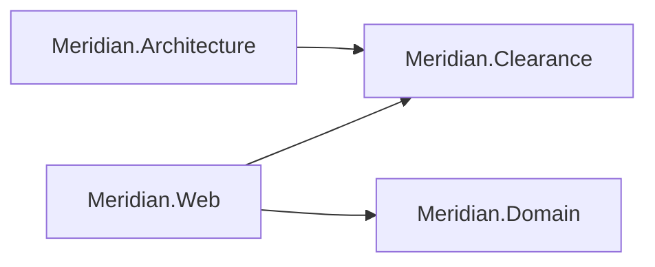
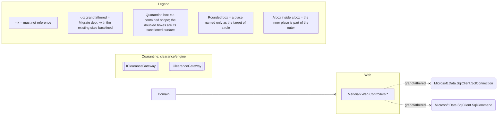

# Architecture: Meridian

This page has two drawings of the same monolith, both written by `sliderule render`. The first is
the codebase survey of the projects and the references between them, drawn from what the code does.
A solid arrow there is a reference some type makes, and a dotted arrow would be a project reference
that is declared and never used. The second is the architecture law, drawn from the spec.

Meridian has three postures at once, so its law fence is the one place where the difference
between them shows as shapes. A solid arrow ending in a cross is law this code already keeps, and a
dotted arrow is grandfathered debt, baselined and counting down. The box labelled `Quarantine:` is the
quarantined scope, and its doubled boxes are the only way into it. Any other box inside a box is a
place inside a larger one, such as the controllers' namespace inside Web.

<!-- sliderule:begin -->
*Generated by `sliderule render` from `Meridian.slnx` — do not edit between the markers; re-render to update.*



*Generated by `sliderule render` from `Meridian.Architecture`. Do not edit between the markers; edit the spec and re-render.*



Not drawn in full: `naming/controllers`, `time/inject-clock` (Migrate), `naming/async-suffix` (Migrate), `di/no-buildserviceprovider`, `clearance/engine/tripwire` (Quarantine). Expand any of them with `sliderule explain <rule-id>`.
<!-- sliderule:end -->

The two dotted arrows into `SqlConnection` and `SqlCommand` are the burndown made visible. The
inline-SQL references behind them are on the baseline, counting down as controllers move to
repositories. The cross marks the relation as forbidden, and the dots mark the sites that already
exist as baselined. The drawing shows this one migration as it happens. The clock and async ratchets
are rules about members and names, so they are on the line under the drawing, and `sliderule status`
counts all three.

The quarantine box contains `Meridian.Clearance` alone. `IClearanceGateway` and `ClearanceGateway`
are doubled because they are its sanctioned surface, and new code may reach the ISO 6346
check-digit table inside only through them. The reach that already went past them, from `CustomsController`, is in the
scope's baseline and is not drawn.

The line under the law fence lists the rules it cannot place. Most are about a name, a call or a
shape, which a drawing of places and the references between them cannot show. The last is the
quarantine's tripwire, which has no shape to draw. `sliderule explain <rule-id>` expands any of them.

To redraw both from a checkout:

```bash
dotnet build examples/Meridian/Meridian.slnx
sliderule render examples/Meridian/Meridian.slnx \
  --diagram examples/Meridian/ARCHITECTURE.md
```

A plain `sliderule render` updates the `AGENTS.md` blocks and the model file, and `--diagram` adds
this page. The command passes no project list, because the survey draws only the projects
`Meridian.slnx` declares. The load also reaches the SlideRule contract and the rule pack, which the
spec project references, and `sliderule graph` lists them with a label saying the solution does not
declare them. The spec project is in the survey because the solution declares it. Its arrow into
Clearance is the reference its `typeof()` anchors need, and `check` leaves the spec's own types out of
the rules. The `--diagram-only` and `--diagram-exclude` options narrow the survey to some of the
declared projects, and the law fence is never scoped, because what the spec forbids does not depend
on which projects someone chose to draw.
